# BÁO CÁO BÀI TẬP NHÓM CUỐI KỲ

**Học phần:** Nhận dạng mẫu

**Đề tài:** Dự đoán khả năng vỡ nợ của khách hàng sử dụng thẻ tín dụng

**Giảng viên hướng dẫn:** TS. Nguyễn Xuân Đức

**Học viên thực hiện:** Lưu Ngọc Anh (B26CHKH006), Nguyễn Hoàng Hiệp (B26CHKH042), Nguyễn Anh Quân (B26CHKH080), Hoàng Anh Vũ (B26CHKH103)

---

## MỤC LỤC

Mục lục, danh mục hình và danh mục bảng được Word tạo tự động trong bản .docx.

---

# TÓM TẮT

Đề tài xây dựng bộ phân loại dự đoán khả năng vỡ nợ trong tháng kế tiếp của khách hàng thẻ tín dụng, sử dụng bộ dữ liệu Default of Credit Card Clients (UCI) gồm 30.000 khách hàng tại Đài Loan năm 2005 với 23 đặc trưng về hạn mức, nhân khẩu học và lịch sử thanh toán sáu tháng. Bài toán được phát biểu như một bài toán phân loại hai lớp có mất cân bằng (22,1% vỡ nợ) và chi phí lỗi bất đối xứng.

Phân tích dữ liệu cho thấy lịch sử trễ hạn là nhóm đặc trưng mạnh nhất, tuổi có quan hệ phi tuyến với rủi ro và hai lớp chồng lấn đáng kể trong không gian đặc trưng. Dữ liệu được làm sạch, chia cố định thành train/validation/test (20.976/4.493/4.496) với ràng buộc nhóm cho các hồ sơ trùng đặc trưng, và bổ sung sáu đặc trưng hành vi. Nhóm dùng PR-AUC làm chỉ số chính cho khả năng phân biệt và expected cost $(5\cdot FN + FP)/n$ làm chỉ số chính cho hiệu quả quyết định; ngưỡng được chọn trên validation, độ bất định được ước lượng bằng bootstrap.

Năm mô hình được so sánh: Logistic Regression (cơ sở), HistGradientBoosting, Random Forest, SVM kernel RBF và Gaussian Naive Bayes. HistGradientBoosting được chọn bằng cross-validation, đạt PR-AUC 0,569 (KTC 95% [0,533; 0,601]), ROC-AUC 0,787 và expected cost 0,541 trên tập test, tốt hơn có ý nghĩa thống kê so với Logistic Regression (PR-AUC 0,507; expected cost 0,617) và so với bộ phân loại không dùng đặc trưng. Phân tích lỗi cho thấy phần lớn khách hàng vỡ nợ bị bỏ sót không có dấu hiệu trễ hạn trong sáu tháng quan sát, đây là giới hạn của bộ đặc trưng hiện có.

**Từ khóa:** chấm điểm tín dụng, phân loại mất cân bằng, quy tắc rủi ro tối thiểu Bayes, gradient boosting, PR-AUC.

# DANH MỤC TỪ VIẾT TẮT

| Từ viết tắt | Tiếng Anh | Ý nghĩa |
|---|---|---|
| AP | Average Precision | Precision trung bình theo Recall; dùng làm PR-AUC |
| AUC | Area Under the Curve | Diện tích dưới đường cong |
| CV | Cross-validation | Kiểm định chéo |
| EDA | Exploratory Data Analysis | Phân tích khám phá dữ liệu |
| FN | False Negative | Khách hàng vỡ nợ bị dự đoán là không vỡ nợ (bỏ sót) |
| FP | False Positive | Khách hàng tốt bị dự đoán là vỡ nợ (cảnh báo nhầm) |
| FPR | False Positive Rate | Tỷ lệ dương tính giả |
| KH | – | Khách hàng |
| KTC | Confidence interval | Khoảng tin cậy |
| LDA | Linear Discriminant Analysis | Phân tích biệt thức tuyến tính Fisher |
| NT$ | New Taiwan dollar | Đô la Đài Loan |
| PCA | Principal Component Analysis | Phân tích thành phần chính |
| PR | Precision–Recall | Đường cong Precision theo Recall |
| RBF | Radial Basis Function | Hàm cơ sở bán kính (kernel Gaussian) |
| ROC | Receiver Operating Characteristic | Đường cong Recall theo FPR |
| SMOTE | Synthetic Minority Over-sampling Technique | Kỹ thuật sinh mẫu tổng hợp cho lớp thiểu số |
| SVM | Support Vector Machine | Máy vector hỗ trợ |
| TN | True Negative | Khách hàng tốt được dự đoán đúng |
| TP | True Positive | Khách hàng vỡ nợ được dự đoán đúng |
| UCI | University of California, Irvine | Kho dữ liệu học máy UCI |

# DANH MỤC HÌNH

[[LIST:Hình]]

# DANH MỤC BẢNG

[[LIST:Bảng]]

---

# CHƯƠNG 1. BÀI TOÁN VÀ BỘ DỮ LIỆU

## 1.1. Đặt vấn đề

Trong hoạt động kinh doanh thẻ tín dụng, ngân hàng và các công ty tài chính phải thường xuyên đưa ra những quyết định có ảnh hưởng trực tiếp đến lợi nhuận: có nên phát hành thẻ cho một khách hàng hay không, nên cấp hạn mức bao nhiêu, và khách hàng nào cần được nhắc nợ sớm. Hai loại sai lầm trong các quyết định này có cái giá rất khác nhau. Nếu chấp thuận một khách hàng về sau mất khả năng thanh toán, tổ chức tín dụng mất phần dư nợ gốc. Ngược lại, nếu từ chối nhầm một khách hàng tốt, tổ chức chỉ mất phần doanh thu lãi và phí có thể thu được.

Ở Việt Nam, tín dụng tiêu dùng, thẻ tín dụng và các hình thức "mua trước trả sau" phát triển nhanh trong những năm gần đây, kéo theo yêu cầu kiểm soát nợ xấu ngày càng chặt chẽ. Các mô hình chấm điểm tín dụng (credit scoring), tức là ước lượng xác suất một khách hàng sẽ vỡ nợ dựa trên hồ sơ và lịch sử giao dịch, vì thế là công cụ được sử dụng rộng rãi. Đề tài này xây dựng một mô hình như vậy trên dữ liệu thực tế và xem xét nó dưới góc độ của học phần Nhận dạng mẫu.

## 1.2. Phát biểu bài toán

Nhóm phát biểu bài toán dưới dạng một bài toán phân loại mẫu hai lớp. Mỗi khách hàng được biểu diễn bằng một vector đặc trưng $x \in \mathbb{R}^{23}$, gồm hạn mức tín dụng, thông tin nhân khẩu học và lịch sử thanh toán trong sáu tháng từ tháng 4 đến tháng 9 năm 2005. Mỗi mẫu thuộc một trong hai lớp: $\omega_1$ – vỡ nợ trong tháng 10/2005, hoặc $\omega_2$ – không vỡ nợ.

Nhiệm vụ đặt ra là xây dựng bộ phân loại $g(x)$ ước lượng xác suất hậu nghiệm $P(\omega_1 \mid x)$ và từ đó gán khách hàng vào một trong hai lớp. Vì số khách hàng vỡ nợ ít hơn nhiều so với số khách hàng trả nợ bình thường, đây là bài toán phân loại nhị phân có mất cân bằng lớp. Ngoài ra, do chi phí của hai loại lỗi không bằng nhau, ngưỡng quyết định cần được chọn theo quy tắc rủi ro tối thiểu Bayes thay vì mặc định ở mức 0,5.

## 1.3. Mục tiêu của đề tài

- Phân tích dữ liệu để tìm ra những yếu tố giúp phân biệt khách hàng vỡ nợ với khách hàng không vỡ nợ, làm cơ sở cho bước tiền xử lý và xây dựng đặc trưng.
- Xây dựng mô hình cơ sở là hồi quy logistic, và bốn mô hình thay thế đại diện cho các cách tiếp cận khác nhau trong Nhận dạng mẫu: bộ phân loại sinh Gaussian Naive Bayes, SVM với kernel RBF, và hai mô hình tập hợp cây quyết định là Random Forest và HistGradientBoosting kết hợp các đặc trưng hành vi bổ sung.
- So sánh năm mô hình trên cùng một phép chia dữ liệu và cùng một khung đánh giá, bằng các độ đo phù hợp với dữ liệu mất cân bằng (PR-AUC, ROC-AUC, Recall, Precision), kèm khoảng tin cậy bootstrap.
- Xử lý sự bất đối xứng chi phí giữa hai loại lỗi bằng cách chọn ngưỡng quyết định theo ma trận chi phí giả định, nhằm tối thiểu hoá tổn thất kỳ vọng, thay vì thay đổi phân bố dữ liệu huấn luyện.
- Phân tích lỗi, giải thích kết quả của mô hình và chỉ ra các hạn chế của giải pháp.

## 1.4. Nguồn dữ liệu

Bộ dữ liệu Default of Credit Card Clients do I-Cheng Yeh đóng góp lên UCI Machine Learning Repository [2], được thu thập từ khách hàng thẻ tín dụng của một ngân hàng tại Đài Loan, giới thiệu lần đầu trong bài báo của Yeh và Lien [1] và phát hành theo giấy phép CC BY 4.0 (Bảng 1.1).

**Bảng 1.1.** Thông tin nguồn dữ liệu (theo trang UCI)

| Thuộc tính | Nội dung |
|---|---|
| Kho dữ liệu | UCI Machine Learning Repository, mã 350; DOI 10.24432/C55S3H |
| Đường dẫn | https://archive.ics.uci.edu/dataset/350/default+of+credit+card+clients |
| Tác giả, bài báo gốc | I-Cheng Yeh; Yeh & Lien (2009), Expert Systems with Applications [1] |
| Giấy phép | Creative Commons Attribution 4.0 International (CC BY 4.0) |
| Quy mô | 30.000 mẫu, 23 đặc trưng số nguyên/số thực, không có giá trị thiếu |
| Phạm vi | Khách hàng thẻ tín dụng tại Đài Loan, tháng 4–9/2005; đơn vị tiền NT$ |
| Tệp dữ liệu | default of credit card clients.xls (5,3 MB) |

Nghiên cứu gốc so sánh sáu phương pháp khai phá dữ liệu và nhấn mạnh rằng, dưới góc độ quản trị rủi ro, ước lượng chính xác xác suất vỡ nợ có giá trị hơn kết quả phân loại nhị phân đơn thuần; trong sáu phương pháp, chỉ mạng nơ-ron ước lượng tốt xác suất này [1]. Vì vậy nhóm quan tâm đến chất lượng điểm số mà mô hình đưa ra chứ không chỉ nhãn dự đoán, vì quyết định theo quy tắc rủi ro tối thiểu Bayes chỉ đúng khi xác suất hậu nghiệm được ước lượng tốt.

## 1.5. Mô tả bộ dữ liệu

Bộ dữ liệu gồm 30.000 khách hàng, mỗi khách hàng có 23 đặc trưng đầu vào và một nhãn nhị phân. Dữ liệu không có giá trị thiếu. Hình 1.1 tóm tắt các con số chính và cơ cấu nhãn của bộ dữ liệu.

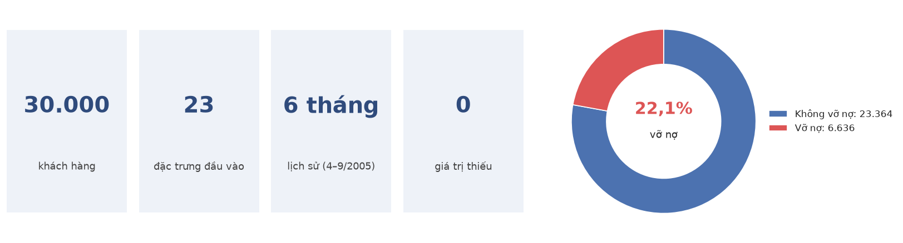

**Hình 1.1.** Tổng quan bộ dữ liệu và cơ cấu nhãn

Về mặt cấu trúc, các đặc trưng chia thành hai phần (Hình 1.2). Phần thứ nhất là thông tin tĩnh của khách hàng gồm hạn mức tín dụng, giới tính, học vấn, tình trạng hôn nhân và tuổi. Phần thứ hai là ba chuỗi số liệu theo tháng, mỗi chuỗi dài sáu tháng: trạng thái trả nợ, dư nợ trên sao kê và số tiền khách hàng đã thanh toán. Nhãn được ghi nhận ở tháng kế tiếp, tức tháng 10/2005. Cần lưu ý rằng các cột được đánh số ngược thời gian: chỉ số 1 (hoặc 0 với PAY) ứng với tháng 9, chỉ số 6 ứng với tháng 4.

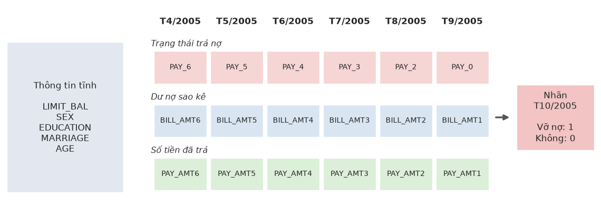

**Hình 1.2.** Cấu trúc một mẫu dữ liệu: thông tin tĩnh và ba chuỗi theo tháng

Theo mô tả của tác giả, biến đầu ra là biến nhị phân default payment (có = 1, không = 0), còn 23 biến giải thích X1 – X23 được lựa chọn dựa trên tổng quan các nghiên cứu trước đó. Bảng 1.2 trình bày tên biến trong tệp dữ liệu, mã biến tương ứng trên trang UCI và ý nghĩa của từng biến.

**Bảng 1.2.** Ý nghĩa các biến trong bộ dữ liệu

| Mã UCI | Tên cột | Kiểu | Ý nghĩa |
|---|---|---|---|
| X1 | LIMIT_BAL | Số | Hạn mức tín dụng được cấp (NT$), bao gồm hạn mức tín dụng tiêu dùng của cá nhân và của gia đình (thẻ phụ). Từ 10.000 đến 1.000.000. |
| X2 | SEX | Định danh | Giới tính: 1 = Nam, 2 = Nữ. |
| X3 | EDUCATION | Định danh | Học vấn: 1 = Sau đại học, 2 = Đại học, 3 = Trung học phổ thông, 4 = Khác. Dữ liệu thực tế còn có mã 0, 5, 6 không được mô tả. |
| X4 | MARRIAGE | Định danh | Tình trạng hôn nhân: 1 = Đã kết hôn, 2 = Độc thân, 3 = Khác. Dữ liệu thực tế còn có mã 0 không được mô tả. |
| X5 | AGE | Số | Tuổi (năm), từ 21 đến 79. |
| X6 – X11 | PAY_0, PAY_2 … PAY_6 | Thứ bậc | Lịch sử trả nợ: X6 là trạng thái tháng 9/2005, X7 là tháng 8/2005, …, X11 là tháng 4/2005. Thang đo gốc: −1 = trả đúng hạn; 1 = trễ một tháng; 2 = trễ hai tháng; …; 9 = trễ từ chín tháng trở lên. Các giá trị −2 và 0 xuất hiện trong dữ liệu nhưng không được mô tả. |
| X12 – X17 | BILL_AMT1 … BILL_AMT6 | Số | Dư nợ trên sao kê (NT$): X12 là tháng 9/2005, X13 là tháng 8/2005, …, X17 là tháng 4/2005. Có thể âm nếu khách hàng thanh toán dư. |
| X18 – X23 | PAY_AMT1 … PAY_AMT6 | Số | Số tiền đã thanh toán (NT$): X18 là tháng 9/2005, X19 là tháng 8/2005, …, X23 là tháng 4/2005. |
| Y | default payment next month | Nhãn | 1 = vỡ nợ, 0 = không vỡ nợ (tháng 10/2005). |

Về nhãn, có 6.636 khách hàng vỡ nợ (22,12%) và 23.364 khách hàng không vỡ nợ (77,88%), tỷ lệ xấp xỉ 1 : 3,5. Mức mất cân bằng này không quá nghiêm trọng nhưng đủ để làm sai lệch đánh giá: một bộ phân loại luôn dự đoán "không vỡ nợ" vẫn đạt độ chính xác 77,88% mà không phát hiện được bất kỳ khách hàng rủi ro nào. Vì vậy độ chính xác (accuracy) không được dùng làm độ đo chính.

## 1.6. Đánh giá chất lượng dữ liệu

Mặc dù không có giá trị thiếu, quá trình kiểm tra cho thấy dữ liệu còn một số điểm bất thường cần xử lý hoặc ghi nhận. Kết quả được tổng hợp trong Bảng 1.3; cách xử lý cụ thể được trình bày ở chương 3.

**Bảng 1.3.** Các vấn đề chất lượng dữ liệu và hướng xử lý

| Vấn đề | Số lượng | Hướng xử lý |
|---|---|---|
| EDUCATION mang mã 0, 5, 6 không có trong mô tả | 345 mẫu | Gộp vào nhóm 4 (Khác) |
| MARRIAGE mang mã 0 | 54 mẫu | Gộp vào nhóm 3 (Khác) |
| PAY_x có giá trị −2 và 0 không có trong mô tả | Rất phổ biến (PAY_0 = 0 có 14.737 mẫu) | Giữ nguyên dưới dạng biến thứ bậc |
| PAY_2…PAY_6 gần như không có giá trị 1 (PAY_2: 28 mẫu, PAY_6: 0 mẫu) trong khi PAY_0 = 1 có 3.688 mẫu | – | Ghi nhận như một hạn chế về cách mã hoá dữ liệu |
| BILL_AMT âm ở ít nhất một tháng | 1.930 khách hàng | Hợp lệ (khách thanh toán dư), giữ nguyên |
| BILL_AMT bằng 0 trong cả sáu tháng | 866 khách hàng | Khách hàng không sử dụng thẻ, giữ nguyên |
| Dòng trùng lặp (không tính cột ID) | 35 dòng | Loại bỏ để tránh trùng lặp giữa tập huấn luyện và tập kiểm tra |
| PAY_AMT lệch phải rất mạnh (hệ số lệch 10 – 30) | – | Biến đổi log(1 + x) khi dùng mô hình nhạy với thang đo |

---

# CHƯƠNG 2. PHÂN TÍCH SƠ BỘ DỮ LIỆU

Chương này trình bày kết quả phân tích thống kê và trực quan hoá nhằm hiểu rõ đặc điểm của dữ liệu trước khi xây dựng mô hình. Các biểu đồ và bảng số liệu được tạo từ dữ liệu gốc bằng mã nguồn của nhóm (tệp `src/eda.py` [18]), sử dụng pandas [13] và NumPy [14] để xử lý dữ liệu, SciPy [17] cho các kiểm định thống kê, scikit-learn [4] cho PCA và LDA, Matplotlib [15] và seaborn [16] để vẽ biểu đồ.

## 2.1. Thống kê mô tả

Bảng 2.1 trình bày thống kê mô tả của một số đặc trưng số tiêu biểu.

**Bảng 2.1.** Thống kê mô tả một số đặc trưng số

| Đặc trưng | Trung bình | Độ lệch chuẩn | Trung vị | Nhỏ nhất | Lớn nhất | Hệ số lệch |
|---|---:|---:|---:|---:|---:|---:|
| LIMIT_BAL | 167.484 | 129.748 | 140.000 | 10.000 | 1.000.000 | 0,99 |
| AGE | 35,5 | 9,2 | 34 | 21 | 79 | 0,73 |
| BILL_AMT1 | 51.223 | 73.636 | 22.382 | −165.580 | 964.511 | 2,66 |
| PAY_AMT1 | 5.664 | 16.563 | 2.100 | 0 | 873.552 | 14,67 |
| PAY_AMT2 | 5.921 | 23.041 | 2.009 | 0 | 1.684.259 | 30,45 |

Các đặc trưng tiền tệ đều có phân phối lệch phải mạnh: giá trị trung bình lớn hơn trung vị nhiều lần và tồn tại những giá trị cực lớn. Chẳng hạn, trung vị của PAY_AMT2 chỉ khoảng 2.000 NT$ trong khi giá trị lớn nhất vượt 1,68 triệu NT$. Do đó, trước khi áp dụng các mô hình nhạy với thang đo như hồi quy logistic, SVM hay LDA, cần chuẩn hoá và biến đổi log cho nhóm đặc trưng này.

## 2.2. Lịch sử trả nợ

Trong số các nhóm đặc trưng, lịch sử trả nợ cho thấy khả năng phân biệt hai lớp rõ rệt nhất. Hình 2.1 (trái) biểu diễn tỷ lệ vỡ nợ theo trạng thái trả nợ của tháng gần nhất (PAY_0), còn Hình 2.1 (phải) biểu diễn tỷ lệ vỡ nợ theo số tháng khách hàng bị trễ hạn trong sáu tháng quan sát.

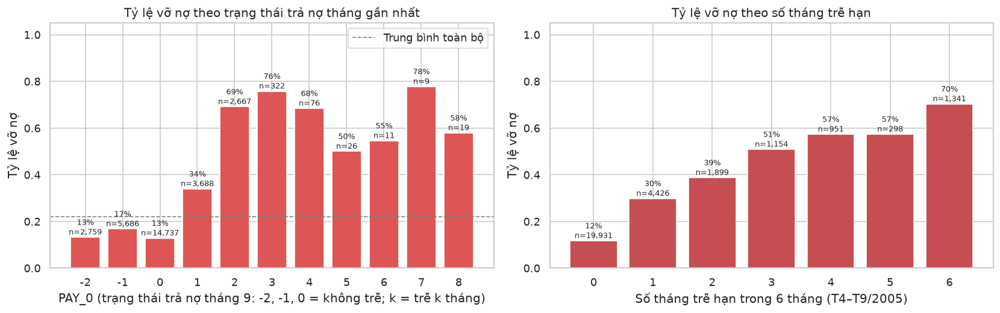

**Hình 2.1.** Tỷ lệ vỡ nợ theo trạng thái trả nợ tháng 9 (trái) và theo số tháng trễ hạn (phải)

**Bảng 2.2.** Tỷ lệ vỡ nợ theo số tháng trễ hạn trong sáu tháng

| Số tháng trễ | 0 | 1 | 2 | 3 | 4 | 5 | 6 |
|---|---:|---:|---:|---:|---:|---:|---:|
| Số khách hàng | 19.931 | 4.426 | 1.899 | 1.154 | 951 | 298 | 1.341 |
| Tỷ lệ vỡ nợ | 11,7% | 29,8% | 38,8% | 50,9% | 57,3% | 57,4% | 70,3% |

**Nhận xét**

- Nhóm khách hàng không trễ hạn ở tháng 9 (PAY_0 ≤ 0, gồm 23.182 người) có tỷ lệ vỡ nợ chỉ từ 13% đến 17%. Khi khách hàng trễ 2 tháng, tỷ lệ này tăng lên 69%, gấp khoảng 5 lần.
- Tỷ lệ vỡ nợ tăng gần như đơn điệu theo số tháng trễ hạn, từ 11,7% lên 70,3%. Đây là cơ sở để tạo đặc trưng mới "số tháng trễ hạn" (mục 3.5).
- PAY_0 cũng là đặc trưng có hệ số tương quan Spearman với nhãn cao nhất trong toàn bộ dữ liệu (ρ = 0,29).

## 2.3. Diễn biến hành vi qua sáu tháng

Để xem xét yếu tố thời gian, nhóm tính giá trị trung bình của từng chuỗi theo tháng, tách riêng cho hai lớp (Hình 2.2).

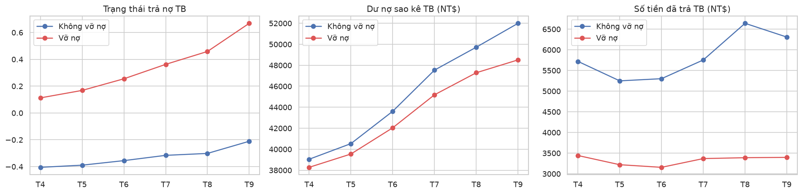

**Hình 2.2.** Giá trị trung bình theo tháng của trạng thái trả nợ, dư nợ và số tiền đã trả, tách theo lớp

Trạng thái trả nợ trung bình của nhóm vỡ nợ xấu đi liên tục, từ 0,11 ở tháng 4 lên 0,67 ở tháng 9, trong khi nhóm không vỡ nợ gần như ổn định trong khoảng −0,4 đến −0,2. Như vậy, vỡ nợ thường không xảy ra đột ngột mà được báo trước bởi một chuỗi trễ hạn ngày càng nặng. Ngược lại, dư nợ sao kê của hai nhóm diễn biến gần như song song và chênh lệch không đáng kể. Khác biệt lớn nằm ở số tiền thanh toán: nhóm vỡ nợ chỉ trả trung bình khoảng 3.200 – 3.400 NT$ mỗi tháng, so với 5.200 – 6.600 NT$ của nhóm còn lại. Điều này cho thấy yếu tố quyết định không phải là khách hàng nợ bao nhiêu, mà là họ trả được bao nhiêu so với khoản nợ đó.

## 2.4. Hạn mức tín dụng và tuổi

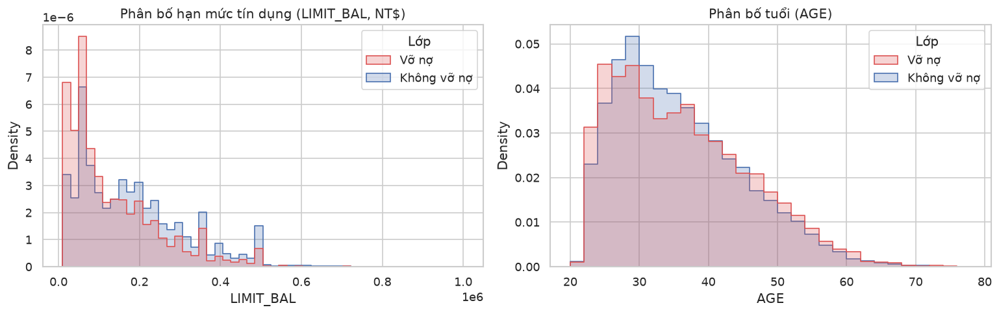

**Hình 2.3.** Phân bố hạn mức tín dụng và tuổi theo lớp

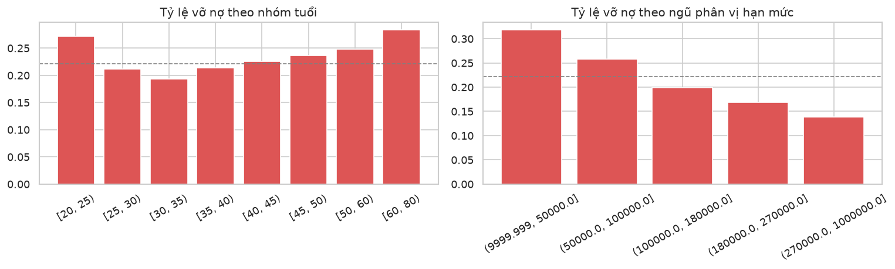

**Hình 2.4.** Tỷ lệ vỡ nợ theo nhóm tuổi (trái) và theo ngũ phân vị hạn mức (phải)

Bảng 2.3 cho tỷ lệ vỡ nợ cụ thể của từng nhóm hạn mức và nhóm tuổi.

**Bảng 2.3.** Tỷ lệ vỡ nợ theo nhóm hạn mức và nhóm tuổi

| Nhóm hạn mức (NT$) | Tỷ lệ vỡ nợ | Nhóm tuổi | Tỷ lệ vỡ nợ |
|---|---:|---|---:|
| ≤ 50.000 | 31,8% | 20 – 24 | 27,2% |
| 50.000 – 100.000 | 25,8% | 25 – 29 | 21,2% |
| 100.000 – 180.000 | 19,9% | 30 – 34 | 19,3% |
| 180.000 – 270.000 | 16,9% | 35 – 49 | 21,4% – 23,6% |
| > 270.000 | 13,8% | 50 – 59 | 24,9% |
| | | Từ 60 | 28,3% |

Hạn mức tín dụng có quan hệ nghịch biến rõ ràng với rủi ro: nhóm hạn mức thấp nhất có tỷ lệ vỡ nợ 31,8%, cao gấp hơn hai lần nhóm hạn mức cao nhất (13,8%). Trung vị hạn mức của nhóm vỡ nợ là 90.000 NT$, thấp hơn đáng kể so với 150.000 NT$ của nhóm không vỡ nợ (kiểm định Mann–Whitney, p < 10⁻¹⁸⁰). Một cách giải thích hợp lý là ngân hàng vốn đã cấp hạn mức thấp cho những khách hàng có hồ sơ yếu, nên hạn mức phản ánh một phần đánh giá rủi ro trước đó.

Tuổi lại có quan hệ hình chữ U với rủi ro. Tỷ lệ vỡ nợ cao ở nhóm trẻ (20 – 24 tuổi) và nhóm lớn tuổi (từ 60 tuổi), thấp nhất ở nhóm 30 – 34 tuổi. Trung vị tuổi của hai lớp đều bằng 34 (Mann–Whitney, p = 0,37) và hệ số tương quan Spearman giữa tuổi và nhãn gần như bằng 0 (ρ = 0,005). Nếu chỉ nhìn vào hệ số tương quan, có thể kết luận sai rằng tuổi không có ý nghĩa. Đây là ví dụ điển hình cho quan hệ phi tuyến mà mô hình tuyến tính khó nắm bắt, trong khi các mô hình dạng cây có thể học được.

## 2.5. Các đặc trưng nhân khẩu học

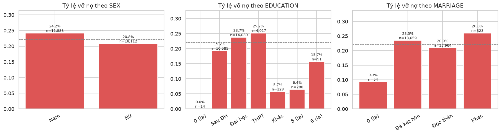

**Hình 2.5.** Tỷ lệ vỡ nợ theo giới tính, học vấn và tình trạng hôn nhân (đường nét đứt là tỷ lệ chung 22,1%)

Bảng 2.4 cho tỷ lệ vỡ nợ theo từng nhóm nhân khẩu học, kèm kết quả kiểm định χ² về mối liên hệ với nhãn.

**Bảng 2.4.** Tỷ lệ vỡ nợ theo nhóm nhân khẩu học và kiểm định χ²

| Đặc trưng | Tỷ lệ vỡ nợ theo nhóm | χ² | p-value |
|---|---|---:|---:|
| SEX | Nam 24,2% – Nữ 20,8% | 47,7 | ≈ 5·10⁻¹² |
| EDUCATION | Sau ĐH 19,2% – Đại học 23,7% – THPT 25,2% | 163,2 | ≈ 10⁻³² |
| MARRIAGE | Đã kết hôn 23,5% – Độc thân 20,9% | 35,7 | ≈ 9·10⁻⁸ |

Kiểm định χ² cho thấy cả ba đặc trưng đều có liên hệ có ý nghĩa thống kê với nhãn. Tuy nhiên, mức chênh lệch thực tế giữa các nhóm chỉ vài điểm phần trăm. Với cỡ mẫu 30.000, kiểm định χ² cho p-value rất nhỏ ngay cả khi hiệu ứng yếu, vì vậy kết quả cần được đọc cùng với độ lớn của chênh lệch. Các mã học vấn không được mô tả (0, 5, 6) có tỷ lệ vỡ nợ thấp và số mẫu ít, nên được gộp vào nhóm "Khác".

Bên cạnh đó, việc sử dụng giới tính, tuổi hay tình trạng hôn nhân để ra quyết định tín dụng đặt ra vấn đề về tính công bằng. Nhóm khảo sát sai số theo giới tính ở mục 6.5, nhưng không đưa ra kết luận về tính công bằng (mục 4.4).

## 2.6. Phân tích tương quan

Do phần lớn đặc trưng có phân phối lệch, nhóm sử dụng hệ số tương quan hạng Spearman thay cho hệ số Pearson. Ma trận tương quan giữa toàn bộ các biến được thể hiện trên Hình 2.6, còn tương quan của từng đặc trưng với nhãn được sắp xếp trên Hình 2.7.

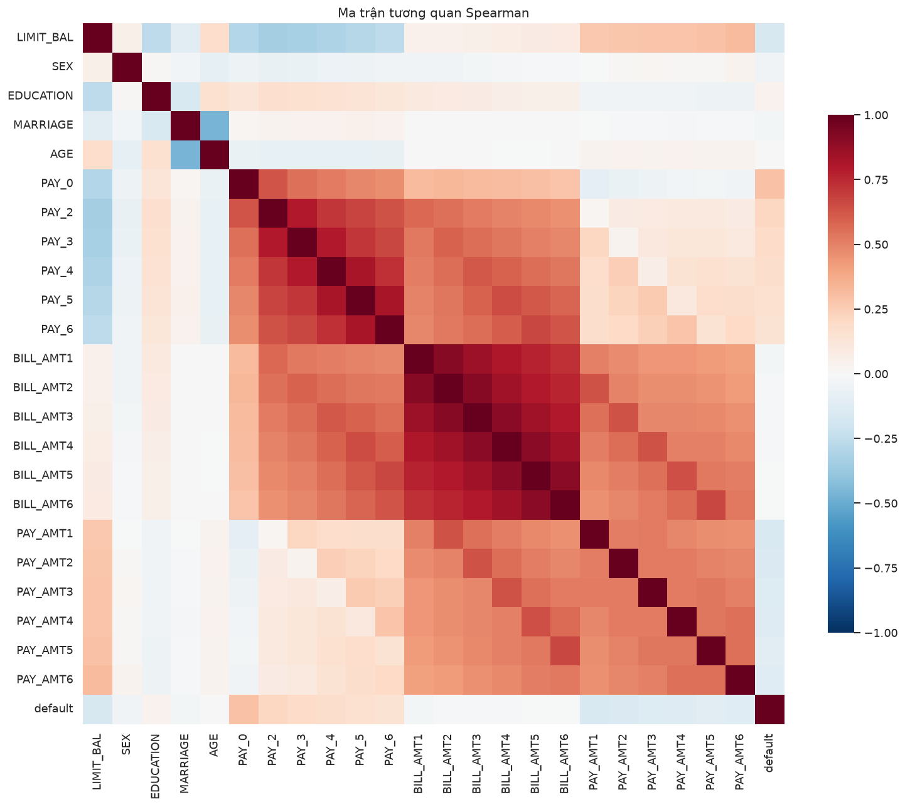

**Hình 2.6.** Ma trận tương quan Spearman giữa các đặc trưng và nhãn

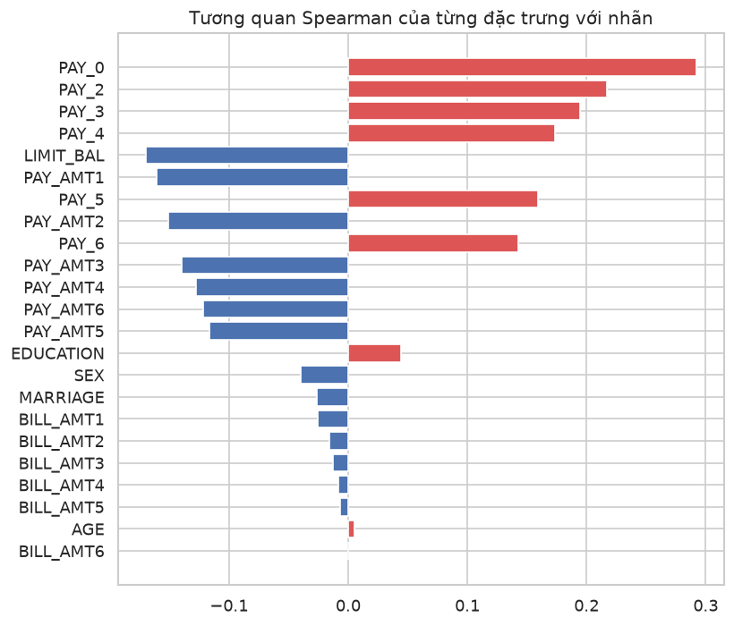

**Hình 2.7.** Hệ số tương quan Spearman của từng đặc trưng với nhãn

Bảng 2.5 tóm tắt mức tương quan với nhãn theo từng nhóm đặc trưng.

**Bảng 2.5.** Mức tương quan với nhãn theo nhóm đặc trưng

| Nhóm đặc trưng | Hệ số Spearman với nhãn |
|---|---|
| PAY_0 … PAY_6 | +0,14 đến +0,29 |
| LIMIT_BAL | −0,17 |
| PAY_AMT1 … PAY_AMT6 | −0,12 đến −0,16 |
| EDUCATION, SEX, MARRIAGE | \|ρ\| < 0,05 |
| BILL_AMT1 … BILL_AMT6, AGE | \|ρ\| ≤ 0,025 |

**Nhận xét**

- Không có đặc trưng đơn lẻ nào tương quan mạnh với nhãn; giá trị cao nhất chỉ là 0,29. Mô hình cần kết hợp thông tin từ nhiều đặc trưng.
- Nhóm BILL_AMT có hiện tượng đa cộng tuyến mạnh: hệ số tương quan giữa hai tháng liền kề khoảng 0,90 – 0,91, giữa tháng 4 và tháng 9 vẫn còn 0,73. Nhóm PAY_x cũng tương quan cao với nhau. Điều này làm hệ số của hồi quy logistic và LDA kém ổn định, và vi phạm giả định độc lập có điều kiện của Naive Bayes.
- Tự thân BILL_AMT gần như không mang thông tin về nhãn, nhưng có thể trở nên hữu ích khi được đặt trong tương quan với hạn mức hoặc với số tiền đã trả (mục 2.8).

## 2.7. Mức độ chồng lấn giữa hai lớp trong không gian đặc trưng

Để đánh giá mức độ khó của bài toán, nhóm chiếu dữ liệu đã chuẩn hoá xuống không gian ít chiều bằng hai phương pháp: phân tích thành phần chính (PCA) và phân tích biệt thức tuyến tính Fisher (LDA). Kết quả được thể hiện trên Hình 2.8.

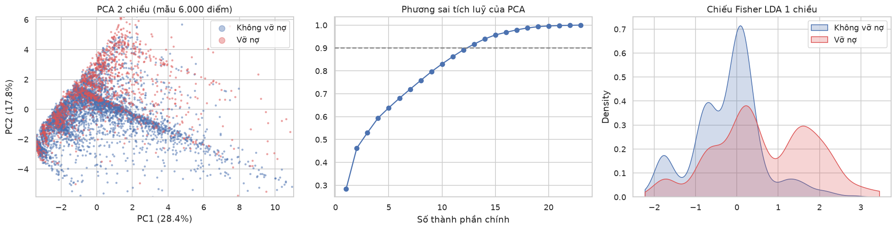

**Hình 2.8.** Chiếu dữ liệu bằng PCA hai chiều (trái), phương sai tích luỹ của PCA (giữa) và chiếu Fisher LDA một chiều (phải)

Hai thành phần chính đầu tiên chỉ giải thích được 46,2% phương sai (28,4% và 17,8%), và cần đến 13 thành phần để đạt 90%. Trên mặt phẳng PC1 – PC2, hai lớp chồng lấn lên nhau rất nhiều. Phép chiếu Fisher LDA, vốn được thiết kế để tối đa hoá khả năng tách hai lớp, cho thấy phân bố của lớp vỡ nợ lệch sang phải và có một đỉnh riêng, nhưng phần lớn vẫn trùng với lớp không vỡ nợ.

Từ đó có thể rút ra rằng sai số Bayes của bài toán không nhỏ: không có bộ phân loại nào tách được hoàn toàn hai lớp với bộ đặc trưng hiện có. Kỳ vọng hợp lý là các mô hình chỉ đạt AUC ở mức trung bình khá, và phần cải tiến cần đến từ việc xây dựng đặc trưng tốt hơn, sử dụng mô hình phi tuyến và chọn ngưỡng quyết định phù hợp với chi phí. Kết quả ở chương 6 xác nhận dự đoán này: ROC-AUC tốt nhất trên tập test là 0,787.

## 2.8. Thử nghiệm một đặc trưng phái sinh

Như đã thấy ở mục 2.6, dư nợ sao kê gần như không tương quan với nhãn. Nhóm thử chia dư nợ tháng 9 cho hạn mức tín dụng để được tỷ lệ sử dụng hạn mức, một chỉ số thường dùng trong thực tế ngành tín dụng (Hình 2.9 và Bảng 2.6).

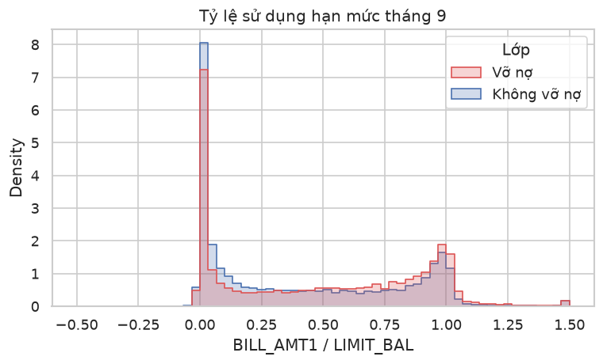

**Hình 2.9.** Phân bố tỷ lệ sử dụng hạn mức tháng 9 theo lớp

**Bảng 2.6.** Tỷ lệ vỡ nợ theo mức sử dụng hạn mức tháng 9

| BILL_AMT1 / LIMIT_BAL | ≤ 0 | 0 – 25% | 25 – 50% | 50 – 75% | 75 – 100% | > 100% |
|---|---:|---:|---:|---:|---:|---:|
| Số khách hàng | 2.596 | 11.440 | 3.588 | 3.579 | 6.680 | 2.115 |
| Tỷ lệ vỡ nợ | 24,8% | 16,8% | 21,7% | 26,0% | 25,8% | 30,1% |

Khác với dư nợ gốc, tỷ lệ sử dụng hạn mức cho thấy xu hướng khá rõ: khách hàng dùng càng gần hết hạn mức thì rủi ro càng cao, từ 16,8% ở nhóm dùng dưới 25% lên 30,1% ở nhóm vượt hạn mức. Riêng nhóm có dư nợ bằng 0 hoặc âm lại có rủi ro tương đối cao (24,8%), có thể do một phần trong số đó là những khách hàng đã ngừng sử dụng thẻ. Kết quả này cho thấy việc xây dựng đặc trưng dựa trên hiểu biết nghiệp vụ có thể khai thác được thông tin mà dữ liệu gốc chưa thể hiện.

## 2.9. Tổng kết và định hướng

Bảng 2.7 tổng hợp các phát hiện chính của chương này cùng với hướng xử lý tương ứng ở các chương sau.

**Bảng 2.7.** Tổng hợp phát hiện và định hướng xử lý

| Phát hiện | Định hướng | Thực hiện ở |
|---|---|---|
| Dữ liệu mất cân bằng (22% vỡ nợ) | Đánh giá bằng PR-AUC, ROC-AUC, Recall; chia dữ liệu có phân tầng; chọn ngưỡng theo chi phí | Mục 3.3, 3.7, 4.2 |
| Lịch sử trả nợ là nhóm đặc trưng mạnh nhất; nhóm vỡ nợ xấu dần qua sáu tháng | Bổ sung đặc trưng: số tháng trễ hạn, mức trễ lớn nhất, xu hướng trễ hạn | Mục 3.5 |
| BILL_AMT gần như không tương quan với nhãn và có đa cộng tuyến | Thêm tỷ lệ sử dụng hạn mức | Mục 3.5 |
| PAY_AMT lệch phải rất mạnh | Biến đổi log(1 + x) | Mục 3.4 |
| Tuổi có quan hệ phi tuyến hình chữ U với rủi ro | Thử mô hình dạng cây và boosting | Chương 5 |
| Mã không được mô tả ở EDUCATION và MARRIAGE | Gộp vào nhóm "Khác" | Mục 3.2 |
| Hai lớp chồng lấn nhiều trong không gian đặc trưng | Không kỳ vọng độ chính xác quá cao; chọn ngưỡng theo quy tắc rủi ro tối thiểu Bayes | Mục 4.2.4 |
| Đặc trưng nhân khẩu học có ý nghĩa thống kê nhưng hiệu ứng nhỏ | Khảo sát sai số theo giới tính | Mục 6.5 |

---

# CHƯƠNG 3. TIỀN XỬ LÝ DỮ LIỆU

## 3.1. Mục tiêu và tổng quan quy trình

Chương này chuyển dữ liệu UCI gốc thành đầu vào cho năm mô hình ở chương 5, với ba yêu cầu: mọi mô hình dùng cùng một bộ dữ liệu đã làm sạch và cùng một phép chia; không có thông tin nào từ validation hay test lọt vào huấn luyện (rò rỉ dữ liệu); và toàn bộ quy trình chạy lại được với kết quả như cũ. Mã nguồn: `src/preprocessing.py`.

Quy trình gồm hai giai đoạn (Hình 3.1). **Giai đoạn A** (bước 1–6) chỉ dùng quy tắc cố định – kiểm tra, loại trùng, gộp mã, xác định nhóm hồ sơ và chia dữ liệu – không ước lượng thống kê nào từ dữ liệu, nên áp dụng trên toàn bộ 30.000 dòng mà không gây rò rỉ. **Giai đoạn B** (bước 7–10) có các bước học tham số từ dữ liệu (như chuẩn hóa), nên được đóng gói thành một `Pipeline` của scikit-learn [4] và chỉ được fit trên train, hoặc trên phần train của từng fold khi cross-validation.

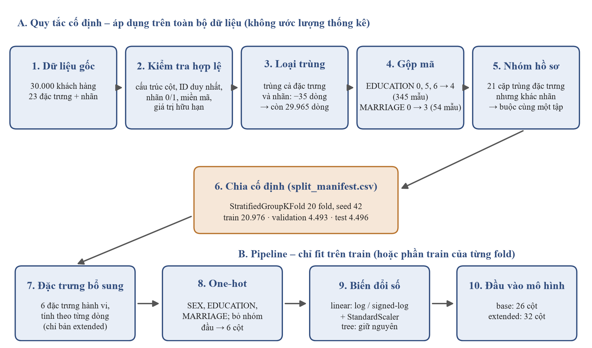

**Hình 3.1.** Quy trình tiền xử lý dữ liệu: giai đoạn A dùng quy tắc cố định, giai đoạn B là pipeline chỉ học từ train

## 3.2. Kiểm tra và làm sạch

**Kiểm tra tính hợp lệ.** Trước khi xử lý, chương trình kiểm tra: đúng 25 cột theo tên gốc của UCI (ID, 23 đặc trưng, nhãn); mọi ô là số hữu hạn; ID duy nhất; nhãn chỉ nhận 0 hoặc 1; mã của SEX, EDUCATION, MARRIAGE và PAY_x nằm trong miền đã biết; hạn mức dương và số tiền thanh toán không âm. Dữ liệu gốc đạt mọi kiểm tra. Nguyên tắc là **dừng lại khi gặp bất thường** thay vì tự điền hay xóa, để lỗi ở nguồn (tải nhầm phiên bản, cột bị lệch) không bị che đi.

**Loại dòng trùng.** 35 dòng trùng hoàn toàn với một dòng khác trên cả 23 đặc trưng lẫn nhãn bị loại (giữ bản đầu tiên), vì hai bản của cùng một hồ sơ có thể rơi vào hai tập khác nhau. Danh sách ID bị loại được lưu để kiểm tra lại.

**Gộp mã không được mô tả.** 345 khách hàng có EDUCATION ∈ {0, 5, 6} được gộp vào nhóm 4 ("Khác") và 54 khách hàng có MARRIAGE = 0 được gộp vào nhóm 3 ("Khác"). Các mã này không có ý nghĩa trong tài liệu gốc và có rất ít mẫu; nếu để riêng, mỗi mã thành một cột one-hot gần như toàn số 0, làm hệ số của mô hình tuyến tính kém ổn định.

**Giữ nguyên** các giá trị PAY = −2 và 0 (rất phổ biến và vẫn mang thông tin, chương 2), dư nợ âm hoặc bằng 0 (thanh toán dư, không dùng thẻ) và các khoản tiền rất lớn (giá trị thật, được nén bằng biến đổi log ở mục 3.4 thay vì cắt bỏ). Kết quả làm sạch ở Bảng 3.1.

**Bảng 3.1.** Kết quả làm sạch

| Nội dung | Trước xử lý | Sau xử lý |
|---|---:|---:|
| Số bản ghi | 30.000 | 29.965 |
| Dòng trùng hoàn toàn khi bỏ ID | 35 | 0 |
| Giá trị thiếu | 0 | 0 |
| EDUCATION mang mã 0, 5, 6 | 345 | 0 (gộp về 4) |
| MARRIAGE mang mã 0 | 54 | 0 (gộp về 3) |
| Số đặc trưng gốc (không tính ID và nhãn) | 23 | 23 |

Cột ID được giữ trong các tệp dữ liệu chỉ để truy vết và **luôn bị loại khỏi đầu vào của mô hình**.

## 3.3. Nhóm hồ sơ, chia dữ liệu và chống rò rỉ

Sau khi gộp mã, có 21 cặp khách hàng giống hệt nhau trên cả 23 đặc trưng nhưng khác nhãn. Cả hai hồ sơ đều được giữ, nhưng mỗi cặp được gom thành một *nhóm* và buộc phải nằm trong cùng một tập. Dữ liệu được chia train/validation/test xấp xỉ 70/15/15 bằng `StratifiedGroupKFold`, vừa phân tầng theo nhãn vừa tôn trọng nhóm, và được lưu cố định trong `data/splits/split_manifest.csv` (chi tiết ở mục 4.1).

Nhóm áp dụng ba nguyên tắc chống rò rỉ theo khuyến nghị của scikit-learn [6]:

1. **Tham số học từ dữ liệu chỉ được ước lượng trên train.** Ví dụ, chuẩn hóa $z = (x - \mu)/\sigma$ dùng $\mu$, $\sigma$ tính trên train rồi áp dụng nguyên cho validation và test; nếu tính trên toàn bộ dữ liệu, thông tin về test đã lọt vào huấn luyện.
2. **Khi cross-validation, tiền xử lý nằm trong pipeline cùng bộ phân loại**, nên được fit lại trên phần train của từng fold.
3. **Đặc trưng bổ sung chỉ tính trên từng dòng** (mục 3.5), không dùng nhãn hay thống kê của nhiều khách hàng.

## 3.4. Mã hóa và biến đổi đặc trưng

**Biến định danh.** SEX, EDUCATION và MARRIAGE là mã tên, không có thứ tự; đưa trực tiếp vào mô hình tuyến tính sẽ khiến mô hình hiểu sai rằng "THPT" (3) lớn gấp ba "Sau đại học" (1). Các biến này được mã hóa one-hot, bỏ nhóm đầu của mỗi biến làm nhóm tham chiếu để tránh phụ thuộc tuyến tính hoàn toàn với hệ số chặn (Bảng 3.2). Miền mã được cố định trước nên mọi tập và mọi fold luôn có cùng 6 cột; mã ngoài miền làm chương trình báo lỗi.

**Bảng 3.2.** Mã hóa one-hot các biến định danh

| Biến | Miền mã sau khi gộp | Nhóm tham chiếu (bị bỏ) | Cột được tạo |
|---|---|---|---|
| SEX | {1, 2} | 1 – Nam | SEX_2 |
| EDUCATION | {1, 2, 3, 4} | 1 – Sau đại học | EDUCATION_2, EDUCATION_3, EDUCATION_4 |
| MARRIAGE | {1, 2, 3} | 1 – Đã kết hôn | MARRIAGE_2, MARRIAGE_3 |

**Biến PAY_x** được giữ dạng số thứ bậc thay vì one-hot: tỷ lệ vỡ nợ tăng gần như đơn điệu theo mức trễ (chương 2), và dạng số giữ thứ tự này chỉ với 6 cột. Đây là một giả định – coi khoảng cách giữa các mã là như nhau – chỉ ảnh hưởng các mô hình tuyến tính; mô hình cây chỉ dùng thứ tự giá trị.

**Biến số.** Hai cấu hình biến đổi được xây dựng cho hai nhóm mô hình (Bảng 3.3):

**Bảng 3.3.** Biến đổi theo nhóm cột trong hai cấu hình

| Nhóm cột | Đặc điểm | Số cột | Cấu hình linear | Cấu hình tree |
|---|---|---:|---|---|
| LIMIT_BAL, PAY_AMT1–6 (và mean_payment) | Không âm, lệch phải rất mạnh | 7 (+1) | $\log(1+x)$, rồi chuẩn hóa | Giữ nguyên |
| BILL_AMT1–6 | Lệch phải mạnh, có giá trị âm | 6 | $\operatorname{sign}(x)\log(1+\|x\|)$, rồi chuẩn hóa | Giữ nguyên |
| AGE, PAY_0–6 (và 5 đặc trưng bổ sung còn lại) | Phân bố không quá lệch | 7 (+5) | Chỉ chuẩn hóa | Giữ nguyên |
| SEX, EDUCATION, MARRIAGE | Biến định danh | 3 → 6 | One-hot | One-hot |

- **Cấu hình linear** (Logistic Regression, SVM, Naive Bayes – các mô hình nhạy với thang đo). Biến đổi $\log(1+x)$ nén giá trị cực lớn: khoản thanh toán lớn nhất của PAY_AMT2 (1.684.259 NT$, gấp khoảng 840 lần trung vị 2.009 NT$) thành 14,34, so với 7,61 của trung vị. Dùng $\log(1+x)$ để giá trị 0 – chiếm 17–24% số tháng thanh toán trên train – vẫn là 0. BILL_AMT dùng signed-log để giữ dấu âm (ví dụ −165.580 thành −12,02). Sau đó mọi cột được chuẩn hóa, để cột hạn mức (hàng trăm nghìn) không lấn át cột PAY_0 (vài đơn vị) trong regularization L2 hay khoảng cách của kernel RBF.
- **Cấu hình tree** (Random Forest, HistGradientBoosting) giữ nguyên thang đo: cây tách dữ liệu theo ngưỡng ("LIMIT_BAL ≤ 50.000?") nên kết quả không đổi qua mọi biến đổi đơn điệu tăng như log hay chuẩn hóa.

Nhóm không dùng PCA (mất khả năng diễn giải, và chương 2 cho thấy cần 13 thành phần để giữ 90% phương sai), không cắt ngoại lệ và không chọn đặc trưng dựa trên nhãn.

## 3.5. Đặc trưng bổ sung

Chương 2 cho thấy một số thông tin quan trọng nằm trong quan hệ giữa các cột chứ không ở từng cột riêng lẻ. Nhóm tạo sáu đặc trưng hành vi (Bảng 3.4). Trên tập train, cả sáu đều khác biệt giữa hai lớp theo đúng hướng đã quan sát ở chương 2: khách hàng vỡ nợ có số tháng trễ trung bình gấp khoảng 4 lần, dùng nhiều hạn mức hơn, trả ít hơn và có nhiều tháng không thanh toán hơn.

**Bảng 3.4.** Các đặc trưng bổ sung và giá trị trung bình theo lớp trên tập train

| Tên | Công thức | Ý nghĩa | Cơ sở | TB không vỡ nợ | TB vỡ nợ |
|---|---|---|---|---:|---:|
| late_month_count | Số tháng có PAY > 0 | Số tháng trễ hạn trong 6 tháng | Bảng 2.2 | 0,49 | 1,97 |
| max_delay | max(0, max(PAY)) | Mức trễ nặng nhất từng có | Mục 2.2 | 0,46 | 1,42 |
| recent_delay_change | PAY_0 − PAY_2 | Trễ hạn tăng (> 0) hay giảm (< 0) trong tháng gần nhất | Mục 2.3 | 0,08 | 0,21 |
| utilization_sep | BILL_AMT1 / LIMIT_BAL | Mức sử dụng hạn mức tháng 9 | Mục 2.8 | 0,41 | 0,49 |
| mean_payment | Trung bình PAY_AMT1 … PAY_AMT6 | Khả năng thanh toán trung bình (NT$) | Mục 2.3 | 5.872 | 3.365 |
| zero_payment_count | Số tháng có PAY_AMT = 0 | Số tháng không thanh toán | Mục 2.3 | 1,06 | 1,74 |

utilization_sep có thể âm (2,0% khách hàng trên train) hoặc lớn hơn 1 (6,9%, dư nợ vượt hạn mức); các giá trị này có ý nghĩa nghiệp vụ nên được giữ nguyên. Các đặc trưng được tính bên trong pipeline, trước bước mã hóa và chuẩn hóa, nên khi dự đoán cho khách hàng mới chỉ cần cung cấp 23 cột gốc.

## 3.6. Bốn cấu hình đầu vào

Kết hợp hai cách biến đổi với hai bộ đặc trưng cho bốn cấu hình (Bảng 3.5). Bản base có 26 cột (20 cột số và 6 cột one-hot); bản extended thêm 6 đặc trưng bổ sung, thành 32 cột.

**Bảng 3.5.** Bốn cấu hình đầu vào và mô hình sử dụng

| Cấu hình | Số cột | Thành phần | Mô hình sử dụng (chương 5) |
|---|---:|---|---|
| linear_base | 26 | 23 đặc trưng gốc, log/signed-log, chuẩn hóa, one-hot | Logistic Regression |
| linear_extended | 32 | linear_base + 6 đặc trưng bổ sung | SVM RBF, Gaussian Naive Bayes |
| tree_base | 26 | 23 đặc trưng gốc, thang đo gốc, one-hot | Không dùng trong thực nghiệm cuối |
| tree_extended | 32 | tree_base + 6 đặc trưng bổ sung | HistGradientBoosting, Random Forest |

Logistic Regression dùng bản base để làm mốc trên dữ liệu gốc; các mô hình thay thế dùng bản extended. Vì vậy chênh lệch giữa mô hình cơ sở và mô hình thay thế phản ánh cả thuật toán lẫn đặc trưng (thảo luận ở mục 6.4); bản tree_base được giữ để có thể tách riêng hai yếu tố này (mục 7.3).

## 3.7. Mất cân bằng lớp và kiểm thử tự động

**Mất cân bằng lớp.** Nhóm giữ nguyên phân bố nhãn (khoảng 22% vỡ nợ) và không dùng SMOTE, undersampling hay trọng số lớp, vì ba lý do: mức mất cân bằng vừa phải (1 : 3,5, train có 4.608 khách hàng vỡ nợ); lấy mẫu lại làm mô hình học sai xác suất tiên nghiệm và đưa ra $P(\text{vỡ nợ} \mid x)$ cao hơn thực tế, mâu thuẫn với việc chọn ngưỡng theo quy tắc Bayes; và bất đối xứng chi phí đã được xử lý trực tiếp bằng ngưỡng tối thiểu hóa expected cost (mục 4.2.4). SMOTE còn có thể sinh giá trị không hợp lệ cho biến thứ bậc (ví dụ PAY_0 = 0,4).

**Kiểm thử tự động.** Bộ kiểm thử `tests/test_preprocessing.py` xác nhận: còn đúng 29.965 dòng và không còn mã chưa gộp; mỗi khách hàng thuộc đúng một tập và không nhóm nào nằm ở hai tập; tỷ trọng các tập lệch dưới 1 điểm phần trăm so với 70/15/15 và tỷ lệ vỡ nợ lệch dưới 1,5 điểm phần trăm so với toàn bộ dữ liệu; chạy lại cho đúng phép chia cũ; bộ tiền xử lý chỉ học từ train (trung bình được lưu khớp với train, và biến đổi một tập validation có giá trị cực lớn không làm thay đổi trạng thái đã fit); các đầu vào lỗi (hạn mức 0, thanh toán âm, mã lạ, nhãn khác 0/1, giá trị thiếu) đều bị từ chối; và bộ tiền xử lý đã lưu cho kết quả giống hệt khi nạp lại. Quy trình dùng pandas [13], NumPy [14] và scikit-learn [4]; bộ tiền xử lý được lưu bằng joblib [19]. Danh sách tệp đầu ra ở Phụ lục A.

---

# CHƯƠNG 4. XÂY DỰNG TẬP ĐÁNH GIÁ

Nhóm xây dựng khung đánh giá thống nhất trước khi phát triển mô hình, gồm cách phân chia dữ liệu, các chỉ số đánh giá và quy trình thực nghiệm. Tất cả mô hình ở chương 5 đều được đánh giá theo khung này.

## 4.1. Phân chia dữ liệu

### 4.1.1. Vai trò của ba tập dữ liệu

Sau bước làm sạch ở chương 3, bộ dữ liệu còn 29.965 khách hàng. Dữ liệu được chia thành ba tập với vai trò tách biệt:

- **Train** dùng để huấn luyện mô hình và chọn cấu hình bằng cross-validation.
- **Validation** chỉ dùng để chọn ngưỡng quyết định.
- **Test** chỉ dùng để đánh giá cấu hình và ngưỡng đã chốt.

### 4.1.2. Ràng buộc nhóm

Mỗi cặp hồ sơ trùng toàn bộ 23 đặc trưng nhưng khác nhãn (21 cặp, mục 3.3) được buộc nằm trọn trong một tập. Nếu không, mô hình có thể được đánh giá trên một vector đặc trưng đã gặp khi huấn luyện. Ràng buộc này chỉ ngăn rò rỉ, không giải quyết mâu thuẫn nhãn: không mô hình nào phân loại đúng cả hai hồ sơ trong một cặp.

### 4.1.3. Quy trình tạo và cố định phép chia

Phép chia được tạo bằng `StratifiedGroupKFold` của scikit-learn [4] với 20 fold, `shuffle=True` và `random_state=42`. Lớp này phân tầng theo nhãn để các fold có tỷ lệ vỡ nợ xấp xỉ nhau, đồng thời xếp mỗi nhóm vào đúng một fold. Fold 0–13 được gán cho train, fold 14–16 cho validation và fold 17–19 cho test, tương ứng tỷ lệ xấp xỉ 70/15/15. Sau khi phân bổ, mã nguồn kiểm tra lại rằng không nhóm nào xuất hiện ở hai tập và mỗi tập đều có đủ hai lớp.

Thứ tự sinh fold phụ thuộc vào phiên bản thư viện: khi chạy lại với scikit-learn 1.9.1, tập train có 20.977 khách hàng thay vì 20.976 và tỷ lệ vỡ nợ của test đổi từ 22,71% thành 22,14%. Vì vậy, nhóm cố định phép chia trong tệp `data/splits/split_manifest.csv`, ghi mã khách hàng, mã nhóm, số fold và tập tương ứng. Tệp này là nguồn phân chia duy nhất cho mọi thành viên.

Bảng 4.1 cho số khách hàng và tỷ lệ vỡ nợ của từng tập sau khi chia.

**Bảng 4.1.** Ba tập dữ liệu dùng để đánh giá

| Tập | Fold | Số khách hàng | Số vỡ nợ | Tỷ lệ vỡ nợ |
|---|---|---:|---:|---:|
| Train | 0–13 | 20.976 | 4.608 | 21,97% |
| Validation | 14–16 | 4.493 | 1.001 | 22,28% |
| Test | 17–19 | 4.496 | 1.021 | 22,71% |
| Tổng | | 29.965 | 6.630 | 22,13% |

### 4.1.4. Kiểm tra mức cân bằng giữa ba tập

Nhóm so sánh tỷ trọng khách hàng giữa ba tập theo bốn tiêu chí: trạng thái trả nợ tháng 9/2005 (PAY_0, gộp thành bốn nhóm {−2, −1}, {0}, {1}, {≥ 2}), hạn mức tín dụng, nhóm tuổi và giới tính. Chênh lệch tỷ trọng lớn nhất giữa ba tập là 1,48 điểm phần trăm, ở nhóm PAY_0 ∈ {−2, −1}; chênh lệch lớn thứ hai là 1,43 điểm phần trăm, ở nhóm tuổi 21–29. Ba tập có mức độ cân bằng tương đối trên bốn tiêu chí khảo sát, tuy kết quả này chưa đủ để khẳng định toàn bộ phân bố dữ liệu giữa các tập là tương đương.

## 4.2. Chỉ số đánh giá

### 4.2.1. Các đại lượng cơ sở

Mô hình gán cho mỗi khách hàng một điểm số $p$. Với ngưỡng $t$, khách hàng có $p \ge t$ được dự đoán là vỡ nợ (lớp dương). Đối chiếu với nhãn thật, mỗi khách hàng thuộc một trong bốn trường hợp: TP, FP, FN và TN. Từ đó:

$$\text{Recall} = \frac{TP}{TP + FN}, \qquad
\text{FPR} = \frac{FP}{FP + TN}, \qquad
\text{Precision} = \frac{TP}{TP + FP}.$$

### 4.2.2. Hạn chế của Accuracy

Bảng 4.2 so sánh hai quy tắc quyết định không dùng đặc trưng nào trên tập test. Quy tắc không cảnh báo khách hàng nào có Accuracy cao hơn nhưng có expected cost (mục 4.2.4) cao hơn quy tắc cảnh báo toàn bộ khách hàng. Accuracy vì vậy có thể đánh giá sai mức độ hữu ích của một quyết định khi chi phí của hai loại lỗi khác nhau, nên chỉ được báo cáo để mô tả.

**Bảng 4.2.** Hai quy tắc quyết định không dùng đặc trưng trên tập test

| Quy tắc | Accuracy | Recall | Expected cost |
|---|---:|---:|---:|
| Không cảnh báo khách hàng nào | 77,3% | 0,0% | 1,135 |
| Cảnh báo toàn bộ khách hàng | 22,7% | 100,0% | 0,773 |

### 4.2.3. Chỉ số đánh giá khả năng phân biệt

- **ROC-AUC**: diện tích dưới đường ROC, bằng xác suất một khách hàng vỡ nợ chọn ngẫu nhiên có điểm số cao hơn một khách hàng không vỡ nợ chọn ngẫu nhiên.
- **PR-AUC**: nhóm dùng Average Precision (`average_precision_score` [4]),

$$\text{AP} = \sum_k (R_k - R_{k-1})\, P_k,$$

trong đó $P_k$ và $R_k$ là Precision và Recall tại ngưỡng thứ $k$. Trong báo cáo, "PR-AUC" được hiểu là AP.

Hai chỉ số này không phụ thuộc vào một ngưỡng cụ thể, nhưng PR-AUC phụ thuộc tỷ lệ vỡ nợ $\pi$ của tập đánh giá vì Precision phụ thuộc $\pi$ [7]:

$$\text{Precision} = \frac{\text{Recall}\cdot\pi}{\text{Recall}\cdot\pi + \text{FPR}\cdot(1-\pi)}.$$

Chẳng hạn, một mô hình có Recall 0,5 và FPR 0,15 có Precision 0,495 khi $\pi$ = 22,7% (như tập test) nhưng chỉ 0,165 khi $\pi$ = 5,6%. Cũng vì vậy, một bộ phân loại không có khả năng phân biệt có PR-AUC bằng $\pi$, còn ROC-AUC luôn bằng 0,5.

Khách hàng vỡ nợ là lớp thiểu số và là lớp cần phát hiện, nên nhóm chọn **PR-AUC làm chỉ số chính cho khả năng phân biệt**; ROC-AUC là chỉ số phụ để đối chiếu với các nghiên cứu khác. Các mô hình chỉ được so sánh trên cùng một tập test.

### 4.2.4. Chỉ số đánh giá hiệu quả quyết định

Nhóm giả định bỏ sót một khách hàng vỡ nợ (FN) gây thiệt hại gấp 5 lần từ chối nhầm một khách hàng tốt (FP): $\lambda_{FN} = 5$, $\lambda_{FP} = 1$. Tỷ lệ 5 : 1 là giả định phục vụ thực nghiệm, không phải một tỷ lệ chi phí phổ quát.

**Expected cost** là chi phí trung bình trên mỗi khách hàng, đo bằng đơn vị tương đối (một đơn vị là chi phí của một FP), và là **chỉ số chính cho hiệu quả quyết định**:

$$C = \frac{5 \cdot FN + 1 \cdot FP}{n}.$$

**Ngưỡng lý thuyết.** Theo quy tắc rủi ro tối thiểu Bayes [3], khách hàng được xếp vào lớp vỡ nợ khi

$$P(\text{vỡ nợ} \mid x) > \frac{\lambda_{FP}}{\lambda_{FP} + \lambda_{FN}} = \frac{1}{6} \approx 0{,}167.$$

**Ngưỡng thực nghiệm.** Ngưỡng lý thuyết chỉ tối ưu khi xác suất dự đoán được hiệu chỉnh tốt. Vì vậy, ngưỡng của mỗi mô hình được chọn trên validation là giá trị cho expected cost nhỏ nhất, và được giữ nguyên khi đánh giá trên test. F1 không được dùng để chọn ngưỡng vì nó đặt trọng số bằng nhau cho FP và FN, mâu thuẫn với giả định 5 : 1.

Bảng 4.3 tóm tắt vai trò của các chỉ số được dùng trong báo cáo.

**Bảng 4.3.** Vai trò của các chỉ số

| Khía cạnh | Chỉ số | Vai trò |
|---|---|---|
| Khả năng phân biệt | PR-AUC (AP) | Chỉ số chính |
| | ROC-AUC | Chỉ số phụ |
| Hiệu quả quyết định | Expected cost | Chỉ số chính, dùng để chọn ngưỡng |
| | Recall, Precision, F1, Accuracy | Mô tả kết quả tại ngưỡng đã chọn |

## 4.3. Quy trình thực nghiệm

### 4.3.1. Các bước đánh giá một mô hình

1. **Chọn cấu hình bằng cross-validation trên train**, dùng `StratifiedGroupKFold` 5 fold với nhóm lấy từ manifest. Tiền xử lý nằm trong pipeline cùng bộ phân loại. Mọi việc dò siêu tham số chỉ diễn ra ở bước này.
2. **Huấn luyện lại** cấu hình đã chọn trên toàn bộ train.
3. **Chọn ngưỡng trên validation** theo expected cost nhỏ nhất.
4. **Đánh giá trên test** với cấu hình và ngưỡng đã chốt.
5. **Ước lượng khoảng tin cậy** bằng bootstrap và **so sánh mô hình** theo các nguyên tắc ở mục 4.3.3.

Khi nhiều cấu hình được thử, giá trị CV của cấu hình được chọn là ước lượng lạc quan của hiệu năng. Vì vậy báo cáo dùng kết quả trên test làm ước lượng hiệu năng tổng quát hóa; giá trị CV chỉ dùng để chọn cấu hình và mô tả độ ổn định giữa các fold.

### 4.3.2. Khoảng tin cậy bootstrap

Nhóm dùng **khoảng tin cậy percentile bootstrap 95%** [5]: lấy mẫu có hoàn lại 4.496 khách hàng từ tập test, tính lại chỉ số với điểm số và ngưỡng giữ nguyên, lặp lại $B = 1.000$ lần, rồi lấy phân vị 2,5% và 97,5%. Đơn vị lấy mẫu là khách hàng; tập test chỉ chứa 5 cặp hồ sơ trùng đặc trưng (10 trên 4.496 khách hàng) nên ảnh hưởng tới giả định độc lập là nhỏ.

### 4.3.3. So sánh các mô hình

Để tránh chọn mô hình dựa trên tập test và tránh vấn đề so sánh bội, nhóm quy định trước bốn nguyên tắc:

- **Chọn mô hình không dùng tập test.** Mô hình được chọn là mô hình có CV PR-AUC cao nhất trên train. Nếu chênh lệch CV PR-AUC giữa mô hình này và Logistic Regression nhỏ hơn một độ lệch chuẩn giữa các fold của mô hình tốt nhất, Logistic Regression được ưu tiên.
- **Báo cáo mọi mô hình trên tập test để mô tả**, kèm khoảng tin cậy 95%, trong một bảng chung không dùng để chọn lại mô hình.
- **Chỉ thực hiện hai phép so sánh định trước** bằng paired bootstrap trên hiệu số $\Delta_{\text{AP}} = \text{AP}_A - \text{AP}_B$ và $\Delta_C = C_A - C_B$: mô hình được chọn so với no-skill baseline (gán cho mọi khách hàng xác suất bằng tỷ lệ vỡ nợ của train), và mô hình được chọn so với Logistic Regression.
- **Diễn giải.** Chỉ kết luận A tốt hơn B theo một chỉ số khi khoảng tin cậy 95% của hiệu số không chứa 0 (nằm hoàn toàn trên 0 với $\Delta_{\text{AP}}$, hoàn toàn dưới 0 với $\Delta_C$).

## 4.4. Phương pháp phân tích lỗi

Mỗi mô hình được phân tích lỗi theo hai cách:

- **Theo nhóm khách hàng:** PR-AUC, Recall, Precision và expected cost trên từng nhóm của bốn tiêu chí ở mục 4.1.4. PR-AUC của từng nhóm được đối chiếu với tỷ lệ vỡ nợ của chính nhóm đó (tỷ lệ này được báo cáo cùng kết quả ở Bảng 6.5), không so trực tiếp giữa các nhóm. Tiêu chí giới tính chỉ dùng để khảo sát khác biệt về hiệu quả dự đoán; nhóm không đưa ra kết luận về tính công bằng, vì điều đó đòi hỏi một tiêu chí công bằng xác định và đánh giá chênh lệch kèm độ bất định.
- **Theo loại lỗi:** so sánh giá trị trung bình của các đặc trưng (hạn mức, tuổi, PAY_0, số tháng trễ hạn, mức sử dụng hạn mức, số tháng không thanh toán) giữa bốn nhóm TP, FN, FP và TN.

---

# CHƯƠNG 5. PHƯƠNG ÁN CƠ SỞ VÀ CÁC PHƯƠNG ÁN THAY THẾ

Chương này trình bày cơ sở lý thuyết, cách cài đặt và lý do lựa chọn cấu hình của năm mô hình. Kết quả thực nghiệm của chúng được trình bày ở chương 6.

## 5.1. Lựa chọn mô hình

Đề bài yêu cầu một mô hình cơ sở và ít nhất một mô hình thay thế. Nhóm chọn **Logistic Regression** làm mô hình cơ sở vì đây là mô hình chuẩn trong chấm điểm tín dụng: đơn giản, ổn định, dễ diễn giải và trực tiếp ước lượng xác suất hậu nghiệm $P(\omega_1 \mid x)$ mà quy tắc quyết định Bayes cần. Bốn mô hình thay thế được chọn sao cho mỗi mô hình đại diện cho một cách tiếp cận khác nhau trong Nhận dạng mẫu và kiểm tra một giả thuyết rút ra từ chương 2 (Bảng 5.1):

- **Gaussian Naive Bayes** – bộ phân loại *sinh* (generative): mô hình hóa phân bố của dữ liệu trong từng lớp rồi suy ra xác suất hậu nghiệm bằng định lý Bayes. Nó cho biết một mô hình dựa trên giả định đơn giản về phân bố đạt được đến đâu.
- **SVM với kernel RBF** – phương pháp *kernel*: tìm biên quyết định phi tuyến bằng cách ánh xạ ngầm dữ liệu sang không gian nhiều chiều hơn.
- **Random Forest** và **HistGradientBoosting** – hai cách *kết hợp nhiều cây quyết định* (bagging và boosting). Chương 2 cho thấy quan hệ phi tuyến (tuổi hình chữ U, rủi ro tăng không đều theo số tháng trễ) và hai lớp chồng lấn nhiều; các mô hình cây có thể học các quan hệ này mà không cần biến đổi đặc trưng.

**Bảng 5.1.** Đặc điểm của năm mô hình

| Mô hình | Cách tiếp cận | Biên quyết định | Giả định chính | Đầu ra | Nhạy thang đo |
|---|---|---|---|---|---|
| Logistic Regression | Phân biệt, tuyến tính | Siêu phẳng | Log-odds tuyến tính theo đặc trưng | Xác suất | Có |
| Gaussian Naive Bayes | Sinh | Bậc hai (theo từng trục) | Đặc trưng độc lập có điều kiện, phân phối Gaussian | Xác suất | Có |
| SVM RBF | Kernel, biên cực đại | Phi tuyến, trơn | Độ tương tự giữa mẫu đo bằng khoảng cách Euclid | Điểm biên (không phải xác suất) | Có |
| Random Forest | Tập hợp cây (bagging) | Phi tuyến, dạng bậc thang | Gần như không giả định phân bố | Xác suất (trung bình các cây) | Không |
| HistGradientBoosting | Tập hợp cây (boosting) | Phi tuyến, dạng bậc thang | Gần như không giả định phân bố | Xác suất | Không |

## 5.2. Thiết lập chung

Mọi mô hình được đóng gói thành một `Pipeline` gồm bộ tiền xử lý (chương 3) và bộ phân loại, nên khi cross-validation bộ tiền xử lý được fit lại trên từng fold. Bảng 5.2 tóm tắt cấu hình đầu vào, tham số cố định và lưới siêu tham số của từng mô hình. Các lưới được chọn nhỏ (2–4 cấu hình) và có ý nghĩa: mỗi siêu tham số trong lưới đều điều khiển độ phức tạp của mô hình, và các giá trị trải theo thang log hoặc theo hai mức "đơn giản / phức tạp". Mọi lưới được cố định trước khi tính kết quả test của mô hình tương ứng.

**Bảng 5.2.** Cấu hình cài đặt của năm mô hình

| Mô hình | Đầu vào | Tham số cố định | Lưới siêu tham số | Số cấu hình |
|---|---|---|---|---:|
| Logistic Regression | linear_base (26 cột) | penalty L2, solver lbfgs, max_iter = 3000 | C ∈ {0,1; 1; 10} | 3 |
| HistGradientBoosting | tree_extended (32 cột) | learning_rate = 0,1; max_iter = 150; không early stopping | max_leaf_nodes ∈ {7; 15}, l2_regularization ∈ {0; 10} | 4 |
| Random Forest | tree_extended (32 cột) | 200 cây; max_features = √d | max_depth ∈ {8; None}, min_samples_leaf ∈ {5; 20} | 4 |
| SVM RBF | linear_extended (32 cột) | gamma = scale; probability = False | C ∈ {0,1; 1; 10} | 3 |
| Gaussian Naive Bayes | linear_extended (32 cột) | – | var_smoothing ∈ {10⁻⁹; 10⁻⁷; 10⁻⁵} | 3 |

Quy trình huấn luyện của mỗi mô hình gồm bốn bước, cài đặt bằng scikit-learn [4]:

1. **Dò siêu tham số** bằng `GridSearchCV` với `StratifiedGroupKFold` 5 fold trên train (nhóm hồ sơ lấy từ manifest, `random_state = 42`). Mỗi cấu hình được chấm bằng PR-AUC trung bình qua 5 fold; ROC-AUC được ghi lại để tham khảo.
2. **Huấn luyện lại** cấu hình có PR-AUC cao nhất trên toàn bộ train (`refit`).
3. **Chọn ngưỡng** trên validation: xét mọi giá trị điểm số xuất hiện trên validation và thêm phương án không cảnh báo ai (ngưỡng = +∞), chọn ngưỡng cho $(5 \cdot FN + FP)$ nhỏ nhất.
4. **Lưu** pipeline đã huấn luyện cùng ngưỡng, rồi tính điểm số trên test.

Nhóm không dùng trọng số lớp cho mô hình nào (mục 3.7): mô hình học trên phân bố nhãn thật, còn bất đối xứng chi phí được xử lý ở bước 3. Các mô hình có yếu tố ngẫu nhiên đều cố định `random_state = 42` để kết quả tái lập được.

## 5.3. Phương án cơ sở: Logistic Regression

**Mô hình.** Logistic Regression giả định log-odds của xác suất vỡ nợ là hàm tuyến tính của đặc trưng [11]:

$$\log\frac{P(\omega_1 \mid x)}{1 - P(\omega_1 \mid x)} = w^\top x + b.$$

Nói cách khác, $P(\omega_1 \mid x) = 1/(1 + e^{-(w^\top x + b)})$: mô hình ước lượng trực tiếp xác suất hậu nghiệm mà không mô hình hóa phân bố của $x$, nên thuộc nhóm mô hình *phân biệt* (discriminative). Biên quyết định $P(\omega_1 \mid x) = t$ là một siêu phẳng trong không gian đặc trưng.

**Huấn luyện.** Với nhãn $y_i \in \{-1, +1\}$, tham số được tìm bằng cách cực tiểu hóa log-loss cộng regularization L2 (dạng cài đặt của scikit-learn):

$$\min_{w,b}\; \frac{1}{2}\|w\|^2 + C\sum_{i=1}^{n}\log\left(1 + e^{-y_i(w^\top x_i + b)}\right).$$

Hàm mục tiêu lồi nên có nghiệm duy nhất, được tìm bằng thuật toán lbfgs. Tham số $C$ cân bằng giữa khớp dữ liệu (số hạng thứ hai) và giữ hệ số nhỏ (số hạng thứ nhất): $C$ nhỏ làm hệ số co về 0, giúp ổn định khi đặc trưng tương quan mạnh. Lưới $C \in \{0{,}1; 1; 10\}$ trải ba bậc độ lớn quanh giá trị mặc định 1.

**Lý do cấu hình.** Mô hình dùng bản `linear_base` (23 đặc trưng gốc) để làm mốc đúng nghĩa: cho biết một mô hình tuyến tính đơn giản trên dữ liệu gốc đạt được bao nhiêu. Biến đổi log và chuẩn hóa ở chương 3 là cần thiết vì log-loss và regularization L2 đều nhạy với thang đo.

**Ưu và nhược điểm với dữ liệu này.** Ưu điểm: ổn định, huấn luyện nhanh, hệ số diễn giải được (mỗi hệ số là thay đổi log-odds khi đặc trưng tăng một độ lệch chuẩn). Nhược điểm: biên tuyến tính không biểu diễn được quan hệ hình chữ U của tuổi hay tương tác giữa đặc trưng; các biến PAY được coi là số nên mô hình giả định mỗi bậc trễ hạn làm log-odds thay đổi như nhau; và đa cộng tuyến của nhóm BILL_AMT (mục 2.6) làm từng hệ số riêng lẻ kém ổn định, dù dự đoán tổng thể ít bị ảnh hưởng.

## 5.4. Phương án thay thế 1: HistGradientBoosting

**Mô hình.** Gradient boosting [9] xây dựng mô hình cộng gồm $M$ cây hồi quy nhỏ $h_m$, mỗi cây được thêm vào để sửa lỗi của các cây trước:

$$F_m(x) = F_{m-1}(x) + \eta\, h_m(x),$$

trong đó $\eta$ là tốc độ học (learning rate). Với bài toán phân loại, $F$ là log-odds và xác suất dự đoán là

$$P(\omega_1 \mid x) = \frac{1}{1 + e^{-F_M(x)}}.$$

**Huấn luyện.** Ở mỗi vòng, thuật toán tính gradient (và đạo hàm bậc hai) của log-loss theo $F_{m-1}$ tại từng mẫu, rồi khớp cây $h_m$ vào các giá trị này: cây mới tập trung vào những khách hàng mà mô hình hiện tại dự đoán sai nhiều nhất. Phiên bản `HistGradientBoostingClassifier` [4] gom giá trị mỗi đặc trưng vào tối đa 255 bin trước khi tìm điểm tách, theo ý tưởng của LightGBM [12], giúp huấn luyện nhanh trên vài chục nghìn mẫu.

**Lý do cấu hình.** Tốc độ học $\eta = 0{,}1$ và $M = 150$ cây được cố định: tăng số cây và giảm tốc độ học có tác dụng gần như thay thế nhau, nên nhóm chỉ dò hai tham số điều khiển độ phức tạp của từng cây. `max_leaf_nodes` ∈ {7; 15} giới hạn số lá mỗi cây, tức mức độ tương tác giữa các đặc trưng mà một cây biểu diễn được. `l2_regularization` ∈ {0; 10} phạt giá trị lớn tại lá, làm mỗi cây đóng góp thận trọng hơn. Early stopping bị tắt vì nó tự tách một phần train làm tập kiểm tra nội bộ mà không tuân thủ ràng buộc nhóm hồ sơ.

**Ưu và nhược điểm với dữ liệu này.** Ưu điểm: học được quan hệ phi tuyến và tương tác (ví dụ, cùng một mức trễ hạn nhưng rủi ro khác nhau tùy hạn mức), không cần chuẩn hóa hay biến đổi log vì cây chỉ dùng thứ tự giá trị, ít bị ảnh hưởng bởi phân phối lệch và giá trị cực lớn, và đầu ra là xác suất dùng được trực tiếp cho quy tắc Bayes. Nhược điểm: khó diễn giải hơn mô hình tuyến tính, có nhiều siêu tham số, và có thể overfit nếu cây quá sâu hoặc quá nhiều vòng – lý do nhóm dùng cây nhỏ và có regularization.

## 5.5. Phương án thay thế 2: Random Forest

**Mô hình.** Random Forest [8] gồm $T$ cây quyết định được huấn luyện độc lập; điểm dự đoán là trung bình xác suất của các cây:

$$s(x) = \frac{1}{T}\sum_{t=1}^{T} p_t(y = 1 \mid x).$$

**Huấn luyện.** Mỗi cây được học trên một mẫu bootstrap (lấy có hoàn lại từ train) và tại mỗi nút chỉ xét một tập con ngẫu nhiên gồm $\sqrt{d}$ đặc trưng (với $d = 32$ là 5 đặc trưng). Hai nguồn ngẫu nhiên này làm các cây khác nhau và ít tương quan với nhau; khi lấy trung bình, phương sai của dự đoán giảm mà độ chệch gần như không đổi. Đây là điểm khác cơ bản với boosting: boosting giảm độ chệch bằng cách xây cây tuần tự, còn Random Forest giảm phương sai bằng cách lấy trung bình nhiều cây song song.

**Lý do cấu hình.** Số cây $T = 200$ đủ để trung bình ổn định (tăng thêm cây không làm mô hình overfit, chỉ tốn thời gian). Lưới dò hai tham số điều khiển kích thước cây: `max_depth` ∈ {8; không giới hạn} và `min_samples_leaf` ∈ {5; 20}. Lá lớn hơn chứa nhiều mẫu hơn, nên xác suất ước lượng tại lá ổn định hơn; điều này quan trọng vì ngưỡng quyết định được chọn trên xác suất chứ không chỉ trên nhãn.

**Ưu và nhược điểm với dữ liệu này.** Ưu điểm: giống boosting, học được quan hệ phi tuyến và không cần biến đổi thang đo; ít nhạy với siêu tham số và khó overfit hơn boosting. Nhược điểm: tốn bộ nhớ và chậm hơn khi dự đoán (200 cây sâu), khó diễn giải, và xác suất trung bình của nhiều cây thường bị co về giữa, ít khi gần 0 hoặc 1.

## 5.6. Phương án thay thế 3: SVM với kernel RBF

**Mô hình.** SVM [10] tìm siêu phẳng phân tách hai lớp với biên (khoảng cách tới các mẫu gần nhất) lớn nhất. Với dữ liệu chồng lấn như bài toán này, dạng *biên mềm* cho phép một số mẫu vi phạm biên thông qua biến bù $\xi_i \ge 0$:

$$\min_{w,b,\xi}\; \frac{1}{2}\|w\|^2 + C\sum_{i=1}^{n}\xi_i,$$

với ràng buộc $y_i(w^\top \phi(x_i) + b) \ge 1 - \xi_i$. Bài toán đối ngẫu chỉ phụ thuộc vào tích vô hướng $\phi(x_i)^\top\phi(x_j)$, được thay bằng kernel RBF $K(x, z) = \exp(-\gamma\|x - z\|^2)$ – tương đương ánh xạ dữ liệu sang một không gian vô hạn chiều mà không cần tính $\phi$ tường minh. Hàm quyết định chỉ phụ thuộc vào các *vector hỗ trợ* (các mẫu có $\alpha_i > 0$, nằm trên hoặc vi phạm biên):

$$s(x) = \sum_i \alpha_i y_i K(x_i, x) + b.$$

**Lý do cấu hình.** $\gamma$ = `scale` $= 1/(d \cdot \operatorname{Var}(X))$ là giá trị mặc định hợp lý khi dữ liệu đã chuẩn hóa; nhóm chỉ dò $C \in \{0{,}1; 1; 10\}$: $C$ lớn phạt vi phạm biên nặng hơn, cho biên quyết định uốn theo dữ liệu nhiều hơn và dễ overfit. Nhóm dùng trực tiếp $s(x)$ (`probability = False`) thay vì xác suất, vì để có xác suất scikit-learn phải chạy thêm một cross-validation nội bộ không tuân thủ ràng buộc nhóm. Do đó ngưỡng của SVM là một giá trị của $s(x)$, không so sánh trực tiếp với ngưỡng xác suất của các mô hình khác và không áp dụng được ngưỡng lý thuyết 1/6.

**Ưu và nhược điểm với dữ liệu này.** Ưu điểm: biên phi tuyến trơn, có nền tảng lý thuyết rõ ràng về biên cực đại và khả năng tổng quát hóa. Nhược điểm: thời gian huấn luyện tăng từ bậc hai đến bậc ba theo số mẫu, nên với khoảng 17.000 mẫu mỗi fold, SVM là mô hình chậm nhất (Bảng 6.1); không cho ra xác suất; nhạy với thang đo; và khi hai lớp chồng lấn nhiều, rất nhiều mẫu trở thành vector hỗ trợ, làm mô hình vừa chậm vừa khó diễn giải.

## 5.7. Phương án thay thế 4: Gaussian Naive Bayes

**Mô hình.** Gaussian Naive Bayes là bộ phân loại *sinh*: thay vì mô hình hóa trực tiếp $P(\omega \mid x)$, nó mô hình hóa phân bố của đặc trưng trong từng lớp $p(x \mid \omega)$ cùng xác suất tiên nghiệm $P(\omega)$, rồi dùng định lý Bayes [3]. Với giả định "ngây thơ" rằng các đặc trưng độc lập có điều kiện theo lớp và mỗi đặc trưng có phân phối Gaussian:

$$P(c \mid x) \propto P(c)\prod_j \mathcal{N}(x_j;\, \mu_{cj}, \sigma_{cj}^2), \qquad c \in \{0, 1\}.$$

**Huấn luyện.** Không cần tối ưu lặp: các tham số được ước lượng hợp lý cực đại trực tiếp từ train – $P(c)$ là tỷ lệ mẫu của lớp, $\mu_{cj}$ và $\sigma_{cj}^2$ là trung bình và phương sai của đặc trưng $j$ trong lớp $c$. Tham số `var_smoothing` cộng vào mọi phương sai một lượng bằng tỷ lệ đó nhân với phương sai lớn nhất, tránh chia cho phương sai gần 0. Về mặt lý thuyết, Gaussian Naive Bayes là trường hợp đặc biệt của bộ phân loại Gaussian bậc hai (QDA) với ma trận hiệp phương sai của mỗi lớp bị giới hạn là ma trận đường chéo, nên biên quyết định là một mặt bậc hai.

**Lý do cấu hình.** Mô hình dùng bản `linear_extended` vì biến đổi log làm các đặc trưng tiền tệ bớt lệch, gần dạng Gaussian hơn. Lưới `var_smoothing` chỉ có ảnh hưởng nhỏ (Phụ lục B); mô hình gần như không có siêu tham số cần dò.

**Ưu và nhược điểm với dữ liệu này.** Ưu điểm: huấn luyện tức thì, ít tham số nên ít overfit, và cho một mốc so sánh từ cách tiếp cận sinh. Nhược điểm: giả định độc lập bị vi phạm rõ rệt – dư nợ của hai tháng liền kề tương quan khoảng 0,90 (mục 2.6), nên mô hình "đếm" cùng một thông tin nhiều lần và đẩy xác suất về gần 0 hoặc 1; các cột one-hot và biến PAY rời rạc cũng không có dạng Gaussian. Vì vậy xác suất của Naive Bayes thường không được hiệu chỉnh tốt, dù thứ hạng giữa các khách hàng vẫn có thể hữu ích.

## 5.8. Liên hệ giữa đặc điểm mô hình và dữ liệu

Đối chiếu đặc điểm của dữ liệu (chương 2) với Bảng 5.1 cho phép đặt ra một số giả thuyết để kiểm tra ở chương 6: hai mô hình tập hợp cây có lợi thế vì học được quan hệ phi tuyến và tương tác mà không cần biến đổi đặc trưng; Gaussian Naive Bayes chịu ảnh hưởng nặng nhất từ đa cộng tuyến vì vi phạm giả định độc lập; SVM có biên phi tuyến nhưng chi phí tính toán lớn nhất; và vì hai lớp chồng lấn nhiều, khoảng cách giữa các mô hình được dự đoán là không lớn. Mục 6.4 thảo luận kết quả thực nghiệm theo từng giả thuyết này.

---

# CHƯƠNG 6. KẾT QUẢ THỰC NGHIỆM VÀ THẢO LUẬN

## 6.1. Chọn cấu hình và họ mô hình trên train

**Bảng 6.1.** Kết quả cross-validation 5 fold theo nhóm trên train (cấu hình tốt nhất của mỗi mô hình)

| Mô hình | CV PR-AUC | CV ROC-AUC | Cấu hình chọn | Thời gian (giây) |
|---|---:|---:|---|---:|
| Logistic Regression | 0,5046 ± 0,0148 | 0,7462 ± 0,0051 | C = 10 | 6 |
| **HistGradientBoosting** | **0,5618 ± 0,0114** | **0,7860 ± 0,0058** | max_leaf_nodes = 7, l2 = 10 | 17 |
| Random Forest | 0,5605 ± 0,0095 | 0,7833 ± 0,0049 | max_depth = 8, min_samples_leaf = 5 | 71 |
| SVM RBF | 0,5225 ± 0,0078 | 0,7203 ± 0,0060 | C = 1 | 307 |
| Gaussian Naive Bayes | 0,4886 ± 0,0177 | 0,7539 ± 0,0072 | var_smoothing = 10⁻⁵ | 7 |

*Giá trị dạng trung bình ± độ lệch chuẩn qua 5 fold. Thời gian là tổng thời gian dò cấu hình và huấn luyện lại, phụ thuộc máy chạy, chỉ mang tính tham khảo. Kết quả của mọi cấu hình đã thử ở Phụ lục B.*

HistGradientBoosting có CV PR-AUC cao nhất. Khoảng cách tới Logistic Regression là 0,0572, lớn hơn nhiều so với một độ lệch chuẩn (0,0114), nên theo quy tắc ở mục 4.3.3, **HistGradientBoosting được chọn làm mô hình đề xuất trước khi xem kết quả test**.

## 6.2. Kết quả trên tập test

Bảng 6.2 trình bày kết quả của năm mô hình và bộ phân loại không dùng đặc trưng (no-skill) trên tập test, tại ngưỡng đã chọn trên validation. Hình 6.1 và Hình 6.2 minh họa cùng kết quả bằng đường cong và ma trận nhầm lẫn.

**Bảng 6.2.** Kết quả trên tập test (4.496 khách hàng, 1.021 vỡ nợ), tại ngưỡng chọn trên validation

| Mô hình | PR-AUC | ROC-AUC | Ngưỡng | Recall | Precision | F1 | Accuracy | Expected cost | FP | FN |
|---|---:|---:|---:|---:|---:|---:|---:|---:|---:|---:|
| Logistic Regression | 0,5071 | 0,7475 | 0,228 | 0,616 | 0,437 | 0,511 | 0,732 | 0,6165 | 812 | 392 |
| **HistGradientBoosting** | **0,5687** | **0,7868** | 0,167 | **0,762** | 0,390 | 0,516 | 0,675 | **0,5414** | 1.219 | **243** |
| Random Forest | 0,5660 | 0,7835 | 0,164 | 0,737 | 0,391 | 0,511 | 0,679 | 0,5598 | 1.172 | 269 |
| SVM RBF | 0,5134 | 0,7112 | −0,993* | 0,607 | 0,438 | 0,509 | 0,734 | 0,6232 | 797 | 401 |
| Gaussian Naive Bayes | 0,4879 | 0,7531 | 0,087 | 0,690 | 0,408 | 0,513 | 0,703 | 0,5785 | 1.021 | 316 |
| No-skill | 0,2271 | 0,5000 | 0,220 | 1,000 | 0,227 | 0,370 | 0,227 | 0,7729 | 3.475 | 0 |

*\* Ngưỡng của SVM là giá trị của hàm quyết định, không phải xác suất.*

Bảng 6.3 cho khoảng tin cậy bootstrap 95% của hai chỉ số chính, cho thấy mức bất định của từng kết quả trong Bảng 6.2.

**Bảng 6.3.** Khoảng tin cậy percentile bootstrap 95% trên tập test (1.000 lần lặp)

| Mô hình | PR-AUC | Expected cost |
|---|---|---|
| Logistic Regression | [0,472; 0,542] | [0,572; 0,660] |
| HistGradientBoosting | [0,533; 0,601] | [0,508; 0,577] |
| Random Forest | [0,532; 0,600] | [0,526; 0,597] |
| SVM RBF | [0,478; 0,546] | [0,584; 0,667] |
| Gaussian Naive Bayes | [0,454; 0,522] | [0,541; 0,619] |
| No-skill | [0,215; 0,240] | [0,760; 0,785] |


**Hình 6.1.** Đường Precision–Recall (trái) và ROC (phải) của các mô hình trên tập test


**Hình 6.2.** Ma trận nhầm lẫn của các mô hình trên tập test, tại ngưỡng chọn trên validation

## 6.3. So sánh định trước bằng paired bootstrap

Bảng 6.4 trình bày hai phép so sánh đã định trước ở mục 4.3.3, ước lượng bằng paired bootstrap.

**Bảng 6.4.** Hiệu số A − B trên tập test và khoảng tin cậy 95% (paired bootstrap, 1.000 lần lặp)

| A | B | Chỉ số | Hiệu số | KTC 95% | Kết luận |
|---|---|---|---:|---|---|
| HistGradientBoosting | No-skill | PR-AUC | +0,3415 | [+0,3122; +0,3692] | A tốt hơn |
| HistGradientBoosting | No-skill | Expected cost | −0,2309 | [−0,2714; −0,1897] | A tốt hơn |
| HistGradientBoosting | Logistic Regression | PR-AUC | +0,0610 | [+0,0442; +0,0791] | A tốt hơn |
| HistGradientBoosting | Logistic Regression | Expected cost | −0,0765 | [−0,1061; −0,0476] | A tốt hơn |

Cả bốn khoảng tin cậy đều không chứa 0. Như vậy có bằng chứng thống kê rằng HistGradientBoosting tốt hơn no-skill baseline và tốt hơn Logistic Regression trên cả hai khía cạnh: khả năng phân biệt và hiệu quả quyết định. So với no-skill, mô hình giảm expected cost khoảng 30% (từ 0,773 xuống 0,541); so với Logistic Regression, giảm khoảng 12% (từ 0,617 xuống 0,541).

## 6.4. Thảo luận

**Mô hình phi tuyến vượt trội mô hình tuyến tính.** Hai mô hình dạng cây (HistGradientBoosting và Random Forest) dẫn đầu ở cả CV và test, hơn Logistic Regression khoảng 0,06 PR-AUC. Điều này phù hợp với các phát hiện ở chương 2: quan hệ của tuổi với rủi ro có dạng chữ U, và tỷ lệ vỡ nợ tăng theo số tháng trễ hạn nhưng không theo dạng tuyến tính. Tuy vậy, vì Logistic Regression dùng bản `base` còn các mô hình cây dùng bản `extended`, phần cải thiện là của cả pipeline; báo cáo chưa tách được đóng góp riêng của sáu đặc trưng bổ sung.

**HistGradientBoosting và Random Forest gần như tương đương.** Chênh lệch CV PR-AUC chỉ 0,0013, nhỏ hơn nhiều so với độ lệch chuẩn giữa các fold, và hai khoảng tin cậy trên test gần như trùng nhau. Nhóm không thực hiện phép so sánh giữa hai mô hình này vì nó không nằm trong các phép so sánh định trước; kết luận hợp lý là hai mô hình có hiệu năng tương đương trên dữ liệu này. HistGradientBoosting được ưu tiên vì có điểm CV cao hơn và huấn luyện nhanh hơn khoảng bốn lần.

**Đánh đổi giữa FN và FP.** So với Logistic Regression, HistGradientBoosting giảm số khách hàng vỡ nợ bị bỏ sót từ 392 xuống 243 (−149), đổi lại số cảnh báo nhầm tăng từ 812 lên 1.219 (+407). Với tỷ lệ chi phí 5 : 1, việc giảm 149 FN (tiết kiệm 745 đơn vị) lớn hơn chi phí của 407 FP tăng thêm, nên expected cost giảm. Đây cũng là lý do Accuracy của HistGradientBoosting (0,675) thấp hơn Logistic Regression (0,732) dù mô hình tốt hơn theo tiêu chí đã chọn, minh họa đúng hạn chế của Accuracy đã nêu ở mục 4.2.2.

**Ngưỡng thực nghiệm và chất lượng xác suất.** Ngưỡng chọn trên validation của HistGradientBoosting (0,167) và Random Forest (0,164) rất gần ngưỡng lý thuyết Bayes 1/6 ≈ 0,167. Điều này gợi ý xác suất của hai mô hình này tương đối gần với xác suất được hiệu chỉnh trong vùng ngưỡng quan tâm. Ngược lại, ngưỡng của Gaussian Naive Bayes (0,087) lệch xa 1/6, phù hợp với nhận định rằng giả định độc lập bị vi phạm khiến xác suất của Naive Bayes bị đẩy về hai cực. Đây chỉ là quan sát gián tiếp; nhóm chưa đánh giá calibration trực tiếp (ví dụ bằng reliability diagram hay Brier score).

**SVM và Naive Bayes.** SVM RBF có PR-AUC trên test xấp xỉ Logistic Regression nhưng ROC-AUC thấp hơn rõ (0,711 so với 0,747), expected cost cao nhất trong năm mô hình và thời gian huấn luyện lâu nhất. Gaussian Naive Bayes có PR-AUC thấp nhất nhưng ROC-AUC cao hơn Logistic Regression và expected cost thấp hơn (0,579 so với 0,617). Điều này cho thấy hai chỉ số khả năng phân biệt có thể xếp hạng mô hình khác nhau, và một mô hình có khả năng phân biệt kém hơn vẫn có thể cho quyết định tốt hơn tại một ngưỡng cụ thể. Đây là mô tả trên test; các cặp này không thuộc các phép so sánh định trước nên không được kiểm định.

**Tính ổn định giữa validation và test.** Expected cost của HistGradientBoosting trên validation (0,535) và test (0,541) gần nhau, PR-AUC lần lượt là 0,558 và 0,569. Ngưỡng chọn trên validation vì vậy chuyển sang test mà không bị suy giảm đáng kể.

## 6.5. Phân tích lỗi của mô hình đề xuất

**Bảng 6.5.** Kết quả của HistGradientBoosting theo nhóm khách hàng trên tập test

| Tiêu chí | Nhóm | Số KH | Tỷ lệ vỡ nợ | PR-AUC | Recall | Precision | Expected cost |
|---|---|---:|---:|---:|---:|---:|---:|
| PAY_0 | {−2, −1} | 1.274 | 16,6% | 0,325 | 0,602 | 0,273 | 0,596 |
| | {0} | 2.183 | 12,9% | 0,221 | 0,445 | 0,224 | 0,555 |
| | {1} | 544 | 32,9% | 0,459 | 0,983 | 0,367 | 0,585 |
| | {≥ 2} | 495 | 70,7% | 0,777 | 1,000 | 0,707 | 0,293 |
| Hạn mức | ≤ 50k | 1.149 | 30,5% | 0,603 | 0,892 | 0,383 | 0,605 |
| | 50–100k | 721 | 27,0% | 0,585 | 0,749 | 0,453 | 0,584 |
| | 100–180k | 920 | 21,1% | 0,566 | 0,722 | 0,373 | 0,549 |
| | 180–270k | 814 | 17,6% | 0,530 | 0,685 | 0,373 | 0,479 |
| | > 270k | 892 | 15,5% | 0,503 | 0,587 | 0,370 | 0,474 |
| Tuổi | 21–29 | 1.446 | 23,6% | 0,572 | 0,783 | 0,388 | 0,547 |
| | 30–39 | 1.673 | 20,2% | 0,515 | 0,719 | 0,373 | 0,528 |
| | 40–49 | 960 | 24,4% | 0,616 | 0,756 | 0,412 | 0,560 |
| | ≥ 50 | 417 | 25,9% | 0,643 | 0,843 | 0,401 | 0,530 |
| Giới tính | Nam | 1.770 | 25,2% | 0,602 | 0,783 | 0,414 | 0,553 |
| | Nữ | 2.726 | 21,1% | 0,543 | 0,746 | 0,371 | 0,534 |

Bảng 6.6 so sánh giá trị trung bình của các đặc trưng chính giữa bốn loại kết quả TP, FN, FP và TN, để hiểu đặc điểm của khách hàng bị bỏ sót hoặc bị cảnh báo nhầm.

**Bảng 6.6.** Giá trị trung bình của một số đặc trưng theo loại kết quả (HistGradientBoosting, tập test)

| Loại | Số KH | LIMIT_BAL | AGE | PAY_0 | late_month_count | utilization_sep | zero_payment_count |
|---|---:|---:|---:|---:|---:|---:|---:|
| TP | 778 | 119.614 | 36,1 | 1,04 | 2,67 | 0,51 | 2,04 |
| FN | 243 | 186.831 | 35,5 | −0,47 | 0,07 | 0,46 | 0,74 |
| FP | 1.219 | 124.192 | 35,6 | 0,15 | 1,41 | 0,41 | 2,10 |
| TN | 2.256 | 205.395 | 35,5 | −0,41 | 0,05 | 0,39 | 0,58 |

**Nhận xét**

- **Mô hình phụ thuộc mạnh vào lịch sử trễ hạn.** Với khách hàng đã trễ từ 2 tháng ở tháng 9 (PAY_0 ≥ 2), mô hình phát hiện toàn bộ 350 trường hợp vỡ nợ. Ngược lại, ở nhóm PAY_0 = 0, nhóm đông nhất (2.183 khách hàng), Recall chỉ 0,445 và PR-AUC 0,221, chỉ cao hơn không nhiều so với tỷ lệ vỡ nợ của nhóm (12,9%).
- **Khách hàng bị bỏ sót gần như không có dấu hiệu cảnh báo.** Nhóm FN có trung bình chỉ 0,07 tháng trễ hạn, so với 2,67 ở nhóm TP, và có hạn mức trung bình cao (186.831 NT$), gần với nhóm TN. Với bộ đặc trưng hiện có, các khách hàng này gần như không phân biệt được với khách hàng tốt; đây là phần sai số khó giảm bằng cách thay đổi mô hình, phù hợp với nhận định về mức chồng lấn giữa hai lớp ở mục 2.7.
- **Cảnh báo nhầm tập trung ở khách hàng có hồ sơ "xấu" nhưng không vỡ nợ.** Nhóm FP có số tháng trễ hạn trung bình 1,41 và số tháng không thanh toán 2,10, gần với nhóm TP. Đây là những khách hàng có hành vi rủi ro thật nhưng vẫn trả nợ ở tháng 10.
- **Theo hạn mức**, expected cost cao nhất ở nhóm hạn mức thấp (≤ 50k), chủ yếu do tỷ lệ vỡ nợ của nhóm này cao (30,5%); PR-AUC của nhóm vẫn cao hơn rõ rệt so với tỷ lệ vỡ nợ.
- **Theo giới tính**, Recall của nhóm nam (0,783) và nữ (0,746) chênh nhau khoảng 3,6 điểm phần trăm, trong khi tỷ lệ vỡ nợ cũng khác nhau (25,2% so với 21,1%). Theo nguyên tắc ở mục 4.4, nhóm không đưa ra kết luận về tính công bằng từ bảng mô tả này.

## 6.6. Lưu ý về quy trình

Thực nghiệm được thực hiện qua hai đợt. Đợt đầu chỉ gồm Logistic Regression và HistGradientBoosting; kết quả test của hai mô hình này đã được xem trước khi bổ sung Random Forest, SVM RBF và Gaussian Naive Bayes. Lưới siêu tham số của ba mô hình bổ sung được cố định trước khi tính kết quả test của chúng, và không có cấu hình nào được thay đổi sau khi xem test. Tuy vậy, vì cùng một tập test đã được dùng trong quá trình dự án, kết quả của ba mô hình bổ sung mang tính khám phá, chưa phải xác nhận độc lập trên dữ liệu chưa từng quan sát. Kết luận chính (HistGradientBoosting tốt hơn Logistic Regression và no-skill) thuộc đợt đầu và không bị ảnh hưởng.

---

# CHƯƠNG 7. KẾT LUẬN

## 7.1. Kết quả đạt được

- Nhóm đã phân tích bộ dữ liệu Default of Credit Card Clients và xác định lịch sử trả nợ là nhóm đặc trưng mạnh nhất, hạn mức tín dụng có quan hệ nghịch biến với rủi ro, tuổi có quan hệ phi tuyến, và hai lớp chồng lấn đáng kể trong không gian đặc trưng.
- Nhóm xây dựng một quy trình tiền xử lý tránh rò rỉ (ràng buộc nhóm cho hồ sơ trùng đặc trưng, tiền xử lý trong pipeline) và một phép chia cố định dùng chung cho mọi thành viên.
- Nhóm thiết lập khung đánh giá phù hợp với dữ liệu mất cân bằng và chi phí bất đối xứng: PR-AUC và expected cost là hai chỉ số chính, ngưỡng chọn trên validation, khoảng tin cậy bootstrap và các phép so sánh định trước.
- Trong năm mô hình, **HistGradientBoosting** được chọn bằng cross-validation và đạt PR-AUC 0,569 (KTC 95% [0,533; 0,601]), ROC-AUC 0,787 và expected cost 0,541 trên tập test, với Recall 0,762. Mô hình tốt hơn có ý nghĩa thống kê so với Logistic Regression và no-skill baseline trên cả hai chỉ số chính. Random Forest cho kết quả tương đương.

## 7.2. Hạn chế

- **Khả năng khái quát theo thời gian và không gian.** Dữ liệu từ một ngân hàng Đài Loan năm 2005; mọi khách hàng có cùng giai đoạn quan sát. Kết quả không cho thấy mô hình hoạt động tốt ở thời điểm, thị trường hay điều kiện kinh tế khác.
- **Tập test đã được quan sát ở bước EDA** (chương 2) và được dùng qua hai đợt thực nghiệm (mục 6.6).
- **Tỷ lệ chi phí 5 : 1 là giả định**; ngưỡng và thứ hạng các mô hình theo expected cost có thể thay đổi với tỷ lệ khác.
- **Chưa tách đóng góp của đặc trưng bổ sung** khỏi đóng góp của thuật toán (chưa có thực nghiệm ablation trên cùng bộ đặc trưng).
- **Chưa đánh giá calibration trực tiếp**, dù mục tiêu ở chương 1 nhấn mạnh chất lượng xác suất.
- **Lưới siêu tham số nhỏ**, không dùng nested cross-validation; khoảng tin cậy không phản ánh dao động do huấn luyện lại hay chọn ngưỡng.
- **Chưa thử** LDA, XGBoost/LightGBM, kỹ thuật lấy mẫu lại (SMOTE) hay mô hình không dùng đặc trưng nhân khẩu học.

## 7.3. Hướng phát triển

- Thực hiện ablation: chạy Logistic Regression trên bản extended và HistGradientBoosting trên bản base để tách đóng góp của đặc trưng.
- Đánh giá và hiệu chỉnh xác suất (reliability diagram, Brier score, Platt scaling hoặc isotonic regression với phép chia có ràng buộc nhóm).
- Phân tích độ nhạy theo tỷ lệ chi phí (ví dụ 3 : 1, 10 : 1).
- Thử các mô hình boosting khác (XGBoost, LightGBM) và giải thích mô hình bằng SHAP hoặc permutation importance.
- So sánh mô hình có và không có các đặc trưng nhân khẩu học, kèm một tiêu chí công bằng xác định.
- Xây dựng thêm đặc trưng giúp nhận diện nhóm khách hàng vỡ nợ không có dấu hiệu trễ hạn (nhóm FN ở mục 6.5).

---

# TÀI LIỆU THAM KHẢO

[1] I.-C. Yeh and C.-H. Lien, "The comparisons of data mining techniques for the predictive accuracy of probability of default of credit card clients," *Expert Systems with Applications*, vol. 36, no. 2, pp. 2473–2480, 2009.

[2] I.-C. Yeh, "Default of Credit Card Clients" [Dataset], UCI Machine Learning Repository, 2016. DOI: 10.24432/C55S3H. https://archive.ics.uci.edu/dataset/350/default+of+credit+card+clients

[3] R. O. Duda, P. E. Hart and D. G. Stork, *Pattern Classification*, 2nd ed. New York: Wiley, 2001.

[4] F. Pedregosa et al., "Scikit-learn: Machine Learning in Python," *Journal of Machine Learning Research*, vol. 12, pp. 2825–2830, 2011.

[5] B. Efron and R. J. Tibshirani, *An Introduction to the Bootstrap*. Chapman & Hall, 1993.

[6] scikit-learn developers, "Common pitfalls and recommended practices." https://scikit-learn.org/stable/common_pitfalls

[7] T. Saito and M. Rehmsmeier, "The Precision-Recall Plot Is More Informative than the ROC Plot When Evaluating Binary Classifiers on Imbalanced Datasets," *PLOS ONE*, vol. 10, no. 3, e0118432, 2015.

[8] L. Breiman, "Random Forests," *Machine Learning*, vol. 45, no. 1, pp. 5–32, 2001.

[9] J. H. Friedman, "Greedy function approximation: A gradient boosting machine," *The Annals of Statistics*, vol. 29, no. 5, pp. 1189–1232, 2001.

[10] C. Cortes and V. Vapnik, "Support-vector networks," *Machine Learning*, vol. 20, no. 3, pp. 273–297, 1995.

[11] T. Hastie, R. Tibshirani and J. Friedman, *The Elements of Statistical Learning: Data Mining, Inference, and Prediction*, 2nd ed. New York: Springer, 2009.

[12] G. Ke et al., "LightGBM: A highly efficient gradient boosting decision tree," in *Advances in Neural Information Processing Systems 30*, 2017, pp. 3146–3154.

[13] W. McKinney, "Data Structures for Statistical Computing in Python," in *Proceedings of the 9th Python in Science Conference*, 2010, pp. 56–61.

[14] C. R. Harris et al., "Array programming with NumPy," *Nature*, vol. 585, pp. 357–362, 2020.

[15] J. D. Hunter, "Matplotlib: A 2D Graphics Environment," *Computing in Science & Engineering*, vol. 9, no. 3, pp. 90–95, 2007.

[16] M. L. Waskom, "seaborn: statistical data visualization," *Journal of Open Source Software*, vol. 6, no. 60, 3021, 2021.

[17] P. Virtanen et al., "SciPy 1.0: Fundamental Algorithms for Scientific Computing in Python," *Nature Methods*, vol. 17, pp. 261–272, 2020.

[18] Nhóm thực hiện, mã nguồn dự án "credit-card-default-prediction," GitHub. https://github.com/annona17/credit-card-default-prediction

[19] Joblib developers, "Joblib: running Python functions as pipeline jobs." https://joblib.readthedocs.io

---

# PHỤ LỤC A. TÁI LẬP KẾT QUẢ

Mã nguồn: https://github.com/annona17/credit-card-default-prediction. Các lệnh dưới đây chạy từ thư mục gốc của dự án, sau khi tải dữ liệu UCI vào `data/raw/` (trên Windows thay `.venv/bin/python` bằng `.venv\Scripts\python`).

**Môi trường.** Dự án có hai tệp khóa phiên bản, ứng với hai môi trường đã thực sự được dùng:

- `requirements-lock.txt` (Python 3.9, pandas 2.3.3, scikit-learn 1.6.1): môi trường đã tạo phép chia và chạy tiền xử lý, tập đánh giá (chương 3–4). Chỉ môi trường này tái lập đúng `split_manifest.csv` khi chạy lại từ đầu (mục 4.1.3).
- `requirements-modeling-lock.txt` (Python 3.11.4, pandas 2.3.3, scikit-learn 1.9.1, theo `reports/team_modeling_metadata.json`): môi trường đã huấn luyện và đánh giá năm mô hình (chương 5–6). Bước này không chia lại dữ liệu mà đọc phép chia từ manifest đã lưu, nên vẫn dùng đúng các tập train/validation/test của chương 4.

```bash
# Chương 2–4: EDA, tiền xử lý, tập đánh giá
python -m venv .venv
.venv/bin/python -m pip install -r requirements-lock.txt
.venv/bin/python src/eda.py
.venv/bin/python -m src.preprocessing
.venv/bin/python -m src.evaluation
.venv/bin/python -m unittest discover -s tests -v

# Chương 5–6: huấn luyện và đánh giá năm mô hình
python -m venv .venv-model
.venv-model/bin/python -m pip install -r requirements-modeling-lock.txt
.venv-model/bin/python -m src.modeling_team
```

Lệnh `python -m src.preprocessing` sinh ra trong `data/processed/` (không đưa vào Git vì tái tạo được):

- `train.csv`, `validation.csv`, `test.csv`: dữ liệu đã làm sạch, chưa biến đổi, còn giữ cột ID và nhãn để đối chiếu;
- `split_manifest.csv` và `removed_duplicate_ids.csv`: phép chia và danh sách dòng trùng đã loại;
- bốn thư mục `linear_base`, `linear_extended`, `tree_base`, `tree_extended`, mỗi thư mục gồm ba tệp CSV đã biến đổi và bộ tiền xử lý đã fit trên train (`preprocessor.joblib`);
- `metadata.json`: số liệu kiểm tra ở Bảng 3.1, seed, số cột của từng cấu hình, phiên bản numpy/pandas/scikit-learn và mã băm SHA-256 của tệp dữ liệu gốc, để xác nhận mọi thành viên dùng đúng một bộ dữ liệu.

Các kết quả đã lưu trong Git:

| Thành phần | Tệp |
|---|---|
| Phép chia cố định | `data/splits/split_manifest.csv` |
| Bảng EDA | `reports/tables/00_*.csv` … `08_*.csv` |
| Bảng tiền xử lý và tập đánh giá | `reports/tables/09_*.csv`, `10_*.csv` |
| Bảng kết quả mô hình | `reports/tables/12_*.csv` |
| Metadata thực nghiệm | `reports/team_modeling_metadata.json` |
| Notebook | `notebooks/eda_va_tien_xu_ly.ipynb`, `notebooks/ba_phuong_an_bo_sung.ipynb` |

# PHỤ LỤC B. KẾT QUẢ CROSS-VALIDATION CỦA MỌI CẤU HÌNH

Bảng B.1 liệt kê toàn bộ 17 cấu hình đã thử trong lưới siêu tham số (Bảng 5.2), đánh giá bằng cùng 5 fold StratifiedGroupKFold trên train. Cấu hình in đậm là cấu hình được chọn của mỗi mô hình. Số liệu lấy từ `reports/tables/12_cv_all.csv`.

**Bảng B.1.** Kết quả cross-validation 5 fold của mọi cấu hình (trung bình ± độ lệch chuẩn)

| Mô hình | Cấu hình | CV PR-AUC | CV ROC-AUC | Hạng theo PR-AUC |
|---|---|---:|---:|---:|
| Logistic Regression | C = 0,1 | 0,5046 ± 0,0149 | 0,7461 ± 0,0051 | 3 |
| Logistic Regression | C = 1 | 0,5046 ± 0,0148 | 0,7462 ± 0,0051 | 2 |
| Logistic Regression | **C = 10** | 0,5046 ± 0,0148 | 0,7462 ± 0,0051 | 1 |
| HistGradientBoosting | l2_regularization = 0, max_leaf_nodes = 7 | 0,5588 ± 0,0134 | 0,7857 ± 0,0052 | 2 |
| HistGradientBoosting | l2_regularization = 0, max_leaf_nodes = 15 | 0,5579 ± 0,0110 | 0,7824 ± 0,0054 | 3 |
| HistGradientBoosting | **l2_regularization = 10, max_leaf_nodes = 7** | 0,5618 ± 0,0114 | 0,7860 ± 0,0058 | 1 |
| HistGradientBoosting | l2_regularization = 10, max_leaf_nodes = 15 | 0,5568 ± 0,0123 | 0,7843 ± 0,0051 | 4 |
| Random Forest | **max_depth = 8, min_samples_leaf = 5** | 0,5605 ± 0,0095 | 0,7833 ± 0,0049 | 1 |
| Random Forest | max_depth = 8, min_samples_leaf = 20 | 0,5577 ± 0,0115 | 0,7831 ± 0,0045 | 2 |
| Random Forest | max_depth = None, min_samples_leaf = 5 | 0,5529 ± 0,0083 | 0,7778 ± 0,0047 | 4 |
| Random Forest | max_depth = None, min_samples_leaf = 20 | 0,5574 ± 0,0111 | 0,7838 ± 0,0057 | 3 |
| SVM RBF | C = 0,1 | 0,5182 ± 0,0133 | 0,7206 ± 0,0114 | 2 |
| SVM RBF | **C = 1** | 0,5225 ± 0,0078 | 0,7203 ± 0,0060 | 1 |
| SVM RBF | C = 10 | 0,5097 ± 0,0131 | 0,7141 ± 0,0120 | 3 |
| Gaussian Naive Bayes | var_smoothing = 10⁻⁹ | 0,4886 ± 0,0177 | 0,7539 ± 0,0072 | 2 |
| Gaussian Naive Bayes | var_smoothing = 10⁻⁷ | 0,4886 ± 0,0177 | 0,7539 ± 0,0072 | 2 |
| Gaussian Naive Bayes | **var_smoothing = 10⁻⁵** | 0,4886 ± 0,0177 | 0,7539 ± 0,0072 | 1 |

**Nhận xét**

- Với Logistic Regression và Gaussian Naive Bayes, các cấu hình chỉ khác nhau ở chữ số thập phân thứ năm trở đi: kết quả gần như không phụ thuộc vào cường độ regularization hay mức làm trơn phương sai trong lưới đã thử. Cấu hình được chọn vì có giá trị trung bình cao nhất về mặt số học.
- Với HistGradientBoosting và Random Forest, chênh lệch giữa cấu hình tốt nhất và kém nhất (0,0050 và 0,0076) nhỏ hơn độ lệch chuẩn giữa các fold. Các mô hình dạng cây ít nhạy với siêu tham số trong phạm vi đã thử; các cấu hình nông hoặc có regularization (max_leaf_nodes = 7, max_depth = 8) nhỉnh hơn một chút.
- SVM RBF nhạy với $C$ hơn: $C = 10$ làm PR-AUC giảm 0,0128 so với $C = 1$, phù hợp với nguy cơ overfit khi biên quyết định quá khớp với train.

# PHỤ LỤC C. PHÂN CÔNG CÔNG VIỆC

Bảng C.1 liệt kê các thành viên nhóm và mức tự đánh giá đóng góp; Bảng C.2 trình bày phân công công việc theo từng đầu việc.

**Bảng C.1.** Thành viên nhóm và tự đánh giá đóng góp

| STT | Họ và tên | Mã học viên | Tự đánh giá đóng góp |
|---:|---|---|---:|
| 1 | Lưu Ngọc Anh | B26CHKH006 | 25% |
| 2 | Nguyễn Hoàng Hiệp | B26CHKH042 | 25% |
| 3 | Nguyễn Anh Quân | B26CHKH080 | 25% |
| 4 | Hoàng Anh Vũ | B26CHKH103 | 25% |

Nhóm thống nhất đánh giá mức đóng góp của bốn thành viên là như nhau: mỗi thành viên hoàn thành đầy đủ phần việc được giao ở Bảng C.2, cùng tham gia xây dựng các phương án thay thế và cùng thực hiện báo cáo, slide và demo.

**Bảng C.2.** Phân công công việc

| Đầu việc | Người thực hiện | Nội dung trong báo cáo |
|---|---|---|
| Tổng hợp dữ liệu | Lưu Ngọc Anh | Chương 1–2: bài toán, dữ liệu, phân tích sơ bộ |
| Tiền xử lý dữ liệu | Nguyễn Anh Quân | Chương 3 |
| Xây dựng tập đánh giá | Hoàng Anh Vũ | Chương 4 |
| Dựng phương án cơ sở | Nguyễn Hoàng Hiệp | Chương 5–6: Logistic Regression |
| Dựng phương án thay thế | Nguyễn Anh Quân, Nguyễn Hoàng Hiệp, Lưu Ngọc Anh, Hoàng Anh Vũ | Chương 5–6: HistGradientBoosting, Random Forest, SVM RBF, Gaussian Naive Bayes |
| Báo cáo | Cả nhóm | Toàn bộ báo cáo |
| Slide | Cả nhóm | Slide thuyết trình |
| Demo thao tác dữ liệu | Cả nhóm | Phần demo |
