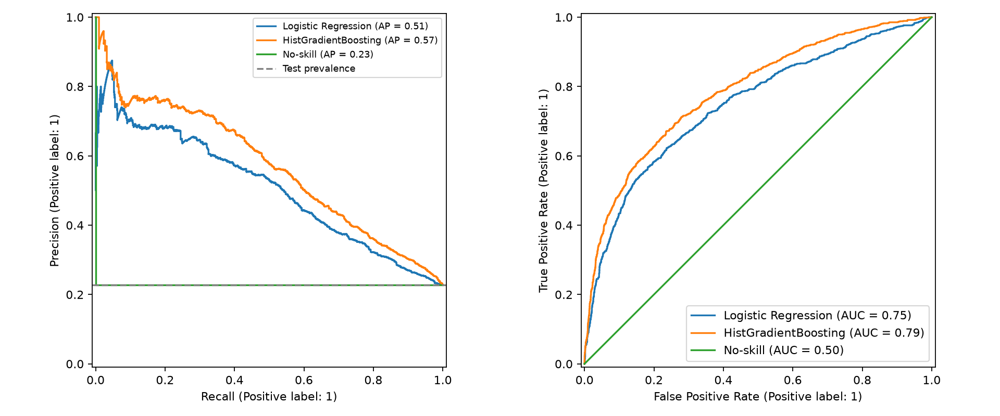
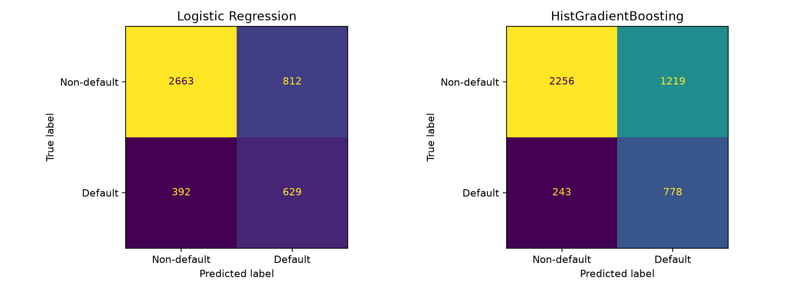

# 4–5. Phương án cơ sở và phương án thay thế — Nguyễn Hoàng Hiệp

## Kế thừa kết quả nhóm

Dùng dữ liệu gốc UCI [1], `clean_data`, `make_preprocessor` của Phần 2 và manifest cố định cùng hàm đánh giá của Phần 3. Không chia lại dữ liệu: train 20.976, validation 4.493, test 4.496. ID và nhãn không nằm trong đầu vào. Chuẩn hóa chỉ fit trên train của từng fold. Ràng buộc nhóm được kiểm tra lại trước khi chạy.

## 4. Phương án cơ sở: Logistic Regression

Logistic Regression mô hình hóa log-odds vỡ nợ như tổ hợp tuyến tính của đặc trưng, dùng regularization L2 [2]. Mô hình dễ tái lập và là mốc cơ sở đã quy định ở Phần 3. Dùng 23 biến gốc qua `linear_base`: gộp mã danh mục theo Phần 2, one-hot, log số tiền dương, signed-log hóa dư nợ, rồi chuẩn hóa. Thử C ∈ {0,1; 1; 10} bằng CV 5 fold theo nhóm trên train, chọn AP trung bình cao nhất. Không cân bằng lớp bằng trọng số; bất đối xứng chi phí được xử lý bằng ngưỡng validation.

## 5. Phương án thay thế: HistGradientBoosting

Mô hình cộng tuần tự các cây quyết định để giảm log-loss, biểu diễn được quan hệ phi tuyến và tương tác giữa đặc trưng [3]. Dùng `tree_extended` của nhóm, bổ sung sáu đặc trưng hành vi, không chuẩn hóa. Giữ learning_rate=0,1, max_iter=150, thử max_leaf_nodes ∈ {7; 15}, l2_regularization ∈ {0; 10}. Tắt early stopping để không tạo thêm phép chia ngẫu nhiên thiếu ràng buộc nhóm. Đây là so sánh hai pipeline hoàn chỉnh; thay đổi đồng thời họ mô hình và tập đặc trưng nên chưa tách riêng đóng góp của sáu biến bổ sung.

## Thiết kế thực nghiệm và chọn mô hình

Hai lưới tham số được cố định trước khi xem test. Dùng StratifiedGroupKFold(5, shuffle=True, random_state=42). Mỗi pipeline được fit lại trên toàn train sau khi chọn cấu hình theo CV AP. Không dùng validation để chọn cấu hình/họ mô hình. Quy tắc đơn giản hóa của Phần 3 được cụ thể hóa: nếu AP trung bình của LR kém mô hình CV tốt nhất ít hơn một SD AP của mô hình tốt nhất thì ưu tiên LR; ngược lại chọn mô hình AP cao nhất. Quy tắc này là quy ước thực nghiệm, không phải kiểm định thống kê.

| Mô hình | CV AP mean | CV AP std | CV ROC mean | CV ROC std | Cấu hình |
| --- | --- | --- | --- | --- | --- |
| Logistic Regression | 0.5046 | 0.0148 | 0.7462 | 0.0051 | {"clf__C": 10.0} |
| HistGradientBoosting | 0.5618 | 0.0114 | 0.7860 | 0.0058 | {"clf__l2_regularization": 10.0, "clf__max_leaf_nodes": 7} |

Mô hình được chọn trước khi xem test: **HistGradientBoosting**. Kết quả CV của cấu hình thắng có thể lạc quan do dò tham số; không dùng làm ước lượng cuối. Sau đó chọn ngưỡng cho từng pipeline bằng min (5FN+FP)/n trên validation, giữ nguyên khi đánh giá test. No-skill gán xác suất bằng tỷ lệ vỡ nợ train. Các mô hình chỉ được huấn luyện trên train; không fit lại trên train+validation sau khi chọn ngưỡng.

## Kết quả test

| Mô hình | PR-AUC | ROC-AUC | Ngưỡng | Recall | Precision | F1 | Accuracy | Chi phí / KH | TP | FP | FN |
| --- | --- | --- | --- | --- | --- | --- | --- | --- | --- | --- | --- |
| Logistic Regression | 0.5071 | 0.7475 | 0.2275 | 0.6161 | 0.4365 | 0.5110 | 0.7322 | 0.6165 | 629.0000 | 812.0000 | 392.0000 |
| HistGradientBoosting | 0.5687 | 0.7868 | 0.1671 | 0.7620 | 0.3896 | 0.5156 | 0.6748 | 0.5414 | 778.0000 | 1219.0000 | 243.0000 |
| No-skill | 0.2271 | 0.5000 | 0.2197 | 1.0000 | 0.2271 | 0.3701 | 0.2271 | 0.7729 | 1021.0000 | 3475.0000 | 0.0000 |

Logistic Regression có AP=0.5071, ROC-AUC=0.7475, chi phí=0.6165. HistGradientBoosting có AP=0.5687, ROC-AUC=0.7868, chi phí=0.5414. Đây là kết quả mô tả trên cùng test; không chọn lại mô hình theo bảng này. Chi phí là đơn vị tương đối với giả định FN:FP=5:1, không phải tiền thực tế.

So với LR, HGB thay đổi số khách vỡ nợ bị bỏ sót từ 392 thành 243, đồng thời số cảnh báo nhầm từ 812 thành 1219. Đánh đổi này giải thích vì sao Accuracy không đi cùng chiều với chi phí: giảm FN được coi trọng gấp 5 lần giảm FP theo giả định đã chốt.

KTC percentile bootstrap 95%, 1.000 mẫu ghép cặp, seed=42, giữ cố định mô hình và ngưỡng:

| Mô hình | PR-AUC 0.025 | PR-AUC 0.975 | Chi phí / KH 0.025 | Chi phí / KH 0.975 |
| --- | --- | --- | --- | --- |
| HistGradientBoosting | 0.5334 | 0.6011 | 0.5076 | 0.5767 |
| Logistic Regression | 0.4718 | 0.5417 | 0.5718 | 0.6597 |
| No-skill | 0.2153 | 0.2396 | 0.7604 | 0.7847 |

Các cặp so sánh định trước: mô hình đã chọn với no-skill, và với LR nếu mô hình đã chọn khác LR. Hiệu số = A − B; AP dương là tốt hơn, chi phí âm là tốt hơn. Chỉ kết luận có bằng chứng khác biệt theo một chỉ số nếu KTC của hiệu số chỉ số đó không chứa 0.

| Chỉ số | Hiệu số | KTC 2,5% | KTC 97,5% | A | B |
| --- | --- | --- | --- | --- | --- |
| PR-AUC | 0.3415 | 0.3122 | 0.3692 | HistGradientBoosting | No-skill |
| Chi phí / KH | -0.2309 | -0.2714 | -0.1897 | HistGradientBoosting | No-skill |
| PR-AUC | 0.0610 | 0.0442 | 0.0791 | HistGradientBoosting | Logistic Regression |
| Chi phí / KH | -0.0765 | -0.1061 | -0.0476 | HistGradientBoosting | Logistic Regression |

- HistGradientBoosting so với No-skill, PR-AUC: có bằng chứng cải thiện; KTC [0.3122; 0.3692].
- HistGradientBoosting so với No-skill, Chi phí / KH: có bằng chứng cải thiện; KTC [-0.2714; -0.1897].
- HistGradientBoosting so với Logistic Regression, PR-AUC: có bằng chứng cải thiện; KTC [0.0442; 0.0791].
- HistGradientBoosting so với Logistic Regression, Chi phí / KH: có bằng chứng cải thiện; KTC [-0.1061; -0.0476].

## Phân tích lỗi

Ba lát cắt có chi phí cao nhất của mô hình đã chọn (các tiêu chí có thể chồng nhau):

| Lát cắt | Nhóm | Số khách | Tỷ lệ vỡ nợ | PR-AUC | Recall | Precision | Chi phí / KH |
| --- | --- | --- | --- | --- | --- | --- | --- |
| Hạn mức | ≤ 50k | 1149.0000 | 0.3055 | 0.6030 | 0.8917 | 0.3826 | 0.6049 |
| PAY_0 | −2 / −1 | 1274.0000 | 0.1656 | 0.3248 | 0.6019 | 0.2725 | 0.5958 |
| PAY_0 | 1 | 544.0000 | 0.3290 | 0.4595 | 0.9832 | 0.3674 | 0.5846 |

Đối chiếu AP từng nhóm với tỷ lệ vỡ nợ của chính nhóm đó. Chi phí cao có thể do tỷ lệ vỡ nợ cao và/hoặc nhiều lỗi; không suy ra nguyên nhân nhân quả hay kết luận công bằng từ các bảng mô tả này. Chỉ số nhóm nhỏ có độ bất định lớn.

Đặc điểm trung bình theo TP/FN/FP/TN (cả hai pipeline):

| Mô hình | Loại lỗi | Số khách | LIMIT_BAL | AGE | PAY_0 | late_month_count | utilization_sep | zero_payment_count |
| --- | --- | --- | --- | --- | --- | --- | --- | --- |
| Logistic Regression | TP | 629.0000 | 108934.8172 | 36.0556 | 1.4658 | 3.1653 | 0.5529 | 2.0843 |
| Logistic Regression | FN | 392.0000 | 178418.3673 | 35.8571 | -0.5867 | 0.2628 | 0.4133 | 1.1684 |
| Logistic Regression | FP | 812.0000 | 111514.7783 | 36.4150 | 0.7586 | 1.9076 | 0.4526 | 2.3719 |
| Logistic Regression | TN | 2663.0000 | 196849.4179 | 35.2557 | -0.5077 | 0.1074 | 0.3782 | 0.7281 |
| HistGradientBoosting | TP | 778.0000 | 119614.3959 | 36.1144 | 1.0360 | 2.6710 | 0.5110 | 2.0424 |
| HistGradientBoosting | FN | 243.0000 | 186831.2757 | 35.5473 | -0.4691 | 0.0658 | 0.4619 | 0.7407 |
| HistGradientBoosting | FP | 1219.0000 | 124191.9606 | 35.6440 | 0.1534 | 1.4061 | 0.4113 | 2.1017 |
| HistGradientBoosting | TN | 2256.0000 | 205394.5035 | 35.4632 | -0.4091 | 0.0536 | 0.3871 | 0.5776 |

Với HistGradientBoosting, nhóm FN có trung bình 0.07 tháng chậm trả, so với 2.67 ở TP; hạn mức trung bình tương ứng 186,831 và 119,614 NT$. Những khách vỡ nợ bị bỏ sót có thể thiếu dấu hiệu chậm trả rõ trong sáu tháng quan sát, cho thấy chỉ lịch sử hành vi hiện có chưa đủ để nhận diện mọi trường hợp.

FN là khách thực sự vỡ nợ bị bỏ sót; mỗi FN đóng góp 5 đơn vị chi phí. FP là cảnh báo nhầm; mỗi FP đóng góp 1 đơn vị. Các giá trị là trung bình mô tả, không phải quy tắc phân loại tất định. Bảng chi tiết mọi lát cắt: `tables/11_error_slices.csv`.

## Hạn chế

- LR giả định log-odds tuyến tính, nên hạn chế khi trạng thái chậm trả có quan hệ phi tuyến với vỡ nợ. Gradient boosting khó giải thích hơn và có thể overfit; lưới tham số nhỏ giới hạn thời gian thực nghiệm.
- Chưa ablation cùng bộ đặc trưng để tách hiệu quả thuật toán và feature engineering; chưa khảo sát calibration, thay đổi chi phí hay độ ổn định qua nhiều seed.
- Kế thừa giới hạn Phần 3: dữ liệu Đài Loan năm 2005, không đánh giá theo thời gian; EDA đã quan sát toàn bộ dữ liệu; không nested CV; bootstrap theo khách hàng và chỉ phản ánh test khi mô hình/ngưỡng đã cố định.
- Kết quả phục vụ bài tập nghiên cứu, không được diễn giải thành bằng chứng khả năng áp dụng cho quần thể hoặc thời điểm khác.

## Tái lập và bàn giao

Chạy `python -m src.modeling` từ gốc repo sau khi cài requirements.txt. Các bảng `11_*.csv` và hai biểu đồ được ghi trong reports. Pipeline cùng ngưỡng lưu ở `outputs/hiep/*.joblib`, manifest/source hash và phiên bản ở `outputs/hiep/selection.json`; thư mục outputs được gitignore. Điểm số theo ID được lưu cục bộ để nhóm tích hợp/đối chiếu. Chạy lại tái lập toàn bộ thí nghiệm; không thay cấu hình sau khi đọc test rồi báo cáo như đánh giá test lần đầu.

## Tài liệu tham khảo

[1] UCI Default of Credit Card Clients. https://archive.ics.uci.edu/dataset/350 — DOI 10.24432/C55S3H.

[2] scikit-learn, LogisticRegression. https://scikit-learn.org/stable/modules/generated/sklearn.linear_model.LogisticRegression.html

[3] scikit-learn, HistGradientBoostingClassifier. https://scikit-learn.org/stable/modules/generated/sklearn.ensemble.HistGradientBoostingClassifier.html
