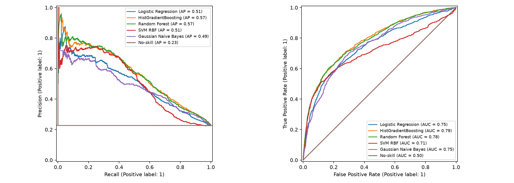
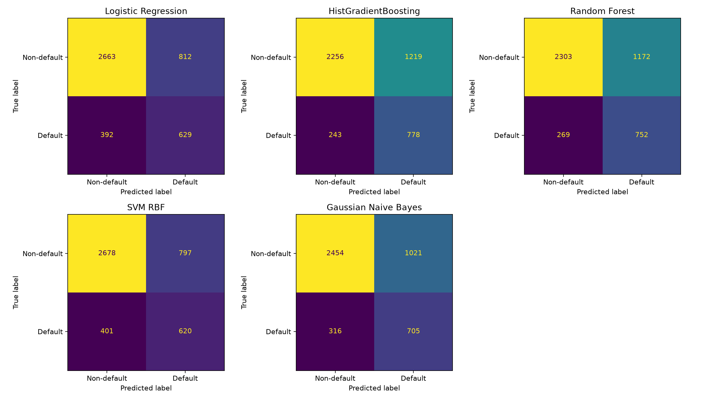

# So sánh chung: một phương án cơ sở và bốn phương án thay thế

## Phạm vi

Phần đã có: Logistic Regression (cơ sở) và HistGradientBoosting (thay thế của Hiệp). Bổ sung Random Forest, SVM RBF, Gaussian Naive Bayes cho ba phần còn lại. Sheet chưa gắn thuật toán cụ thể cho từng người nên báo cáo được tách theo mô hình để nhóm phân công bàn giao; không thay bảng tự đánh giá đóng góp.

- [Random Forest](Bao_cao_Random_Forest.md)
- [SVM RBF](Bao_cao_SVM_RBF.md)
- [Gaussian Naive Bayes](Bao_cao_Gaussian_Naive_Bayes.md)

## Quy trình chung

Giữ nguyên 20.976 train / 4.493 validation / 4.496 test theo manifest, kiểm tra nhóm không giao nhau. Tất cả năm mô hình chạy lại với cùng 5 fold theo nhóm; lưới LR/HGB giữ nguyên đợt trước. Train chọn cấu hình theo AP, validation chỉ chọn ngưỡng chi phí 5FN+FP, test chỉ tính sau khi chốt. Họ mô hình chọn theo CV: ưu tiên LR nếu khoảng cách tới AP tốt nhất nhỏ hơn một SD của mô hình tốt nhất, nếu không chọn AP CV cao nhất. Chưa đặt thứ tự độ phức tạp giữa các mô hình thay thế; không áp quy tắc đơn giản hóa tùy ý giữa chúng.

**Bối cảnh mở rộng:** kết quả test LR/HGB đã được quan sát ở đợt trước, trước khi người dùng yêu cầu thêm ba phương án. Do đó bảng mở rộng là kết quả khám phá trên test đã biết, không được gọi là kiểm định xác nhận trên test hoàn toàn chưa quan sát. Không thay siêu tham số theo kết quả test. Muốn xác nhận độc lập cần dữ liệu mới.

## Chọn cấu hình trên train

| Mô hình | CV AP mean | CV AP std | CV ROC mean | CV ROC std | Fit seconds | Cấu hình |
| --- | --- | --- | --- | --- | --- | --- |
| Logistic Regression | 0.5046 | 0.0148 | 0.7462 | 0.0051 | 6.0945 | {"clf__C": 10.0} |
| HistGradientBoosting | 0.5618 | 0.0114 | 0.7860 | 0.0058 | 17.2321 | {"clf__l2_regularization": 10.0, "clf__max_leaf_nodes": 7} |
| Random Forest | 0.5605 | 0.0095 | 0.7833 | 0.0049 | 70.6580 | {"clf__max_depth": 8, "clf__min_samples_leaf": 5} |
| SVM RBF | 0.5225 | 0.0078 | 0.7203 | 0.0060 | 306.7149 | {"clf__C": 1.0} |
| Gaussian Naive Bayes | 0.4886 | 0.0177 | 0.7539 | 0.0072 | 7.2844 | {"clf__var_smoothing": 1e-05} |

Họ mô hình được chọn bằng CV train: **HistGradientBoosting**. Không chọn lại bằng bảng test. Thời gian fit là tổng thời gian tìm cấu hình và refit, phụ thuộc máy/mức song song; không dùng để so sánh tốc độ thuật toán một cách kiểm soát.

## Kết quả test

| Mô hình | PR-AUC | ROC-AUC | Ngưỡng | Recall | Precision | Chi phí / KH | FP | FN |
| --- | --- | --- | --- | --- | --- | --- | --- | --- |
| Logistic Regression | 0.5071 | 0.7475 | 0.2275 | 0.6161 | 0.4365 | 0.6165 | 812.0000 | 392.0000 |
| HistGradientBoosting | 0.5687 | 0.7868 | 0.1671 | 0.7620 | 0.3896 | 0.5414 | 1219.0000 | 243.0000 |
| Random Forest | 0.5660 | 0.7835 | 0.1641 | 0.7365 | 0.3909 | 0.5598 | 1172.0000 | 269.0000 |
| SVM RBF | 0.5134 | 0.7112 | -0.9928 | 0.6072 | 0.4375 | 0.6232 | 797.0000 | 401.0000 |
| Gaussian Naive Bayes | 0.4879 | 0.7531 | 0.0871 | 0.6905 | 0.4085 | 0.5785 | 1021.0000 | 316.0000 |
| No-skill | 0.2271 | 0.5000 | 0.2197 | 1.0000 | 0.2271 | 0.7729 | 3475.0000 | 0.0000 |

AP (Average Precision) và ROC-AUC chấp nhận điểm liên tục. Riêng SVM dùng decision_function, không phải xác suất, nên ngưỡng SVM không so trực tiếp với ngưỡng các mô hình khác. No-skill dùng tỷ lệ vỡ nợ train làm xác suất cố định. Không dùng Accuracy để chọn mô hình, và không dùng `.predict()` mặc định để tính các chỉ số tại ngưỡng thực nghiệm.

KTC percentile bootstrap 95% với 1.000 lần lấy mẫu theo khách hàng, giữ cố định mô hình/ngưỡng:

| Mô hình | PR-AUC 0.025 | PR-AUC 0.975 | Chi phí / KH 0.025 | Chi phí / KH 0.975 |
| --- | --- | --- | --- | --- |
| Gaussian Naive Bayes | 0.4536 | 0.5223 | 0.5407 | 0.6195 |
| HistGradientBoosting | 0.5334 | 0.6011 | 0.5076 | 0.5767 |
| Logistic Regression | 0.4718 | 0.5417 | 0.5718 | 0.6597 |
| No-skill | 0.2153 | 0.2396 | 0.7604 | 0.7847 |
| Random Forest | 0.5317 | 0.5998 | 0.5258 | 0.5970 |
| SVM RBF | 0.4784 | 0.5464 | 0.5841 | 0.6673 |

## Các cặp so sánh đã chốt theo CV

Chỉ so mô hình được chọn với no-skill và LR (nếu khác LR), theo quy định Phần 3. Không kiểm định mọi cặp. Hiệu số A−B: AP dương, chi phí âm là tốt hơn. Khoảng tin cậy này không loại bỏ ảnh hưởng của việc mở rộng thí nghiệm sau khi đã xem test cũ.

| Chỉ số | Hiệu số | KTC 2,5% | KTC 97,5% | A | B |
| --- | --- | --- | --- | --- | --- |
| PR-AUC | 0.3415 | 0.3122 | 0.3692 | HistGradientBoosting | No-skill |
| Chi phí / KH | -0.2309 | -0.2714 | -0.1897 | HistGradientBoosting | No-skill |
| PR-AUC | 0.0610 | 0.0442 | 0.0791 | HistGradientBoosting | Logistic Regression |
| Chi phí / KH | -0.0765 | -0.1061 | -0.0476 | HistGradientBoosting | Logistic Regression |

- HistGradientBoosting − No-skill, PR-AUC: cải thiện; KTC [0.3122; 0.3692].
- HistGradientBoosting − No-skill, Chi phí / KH: cải thiện; KTC [-0.2714; -0.1897].
- HistGradientBoosting − Logistic Regression, PR-AUC: cải thiện; KTC [0.0442; 0.0791].
- HistGradientBoosting − Logistic Regression, Chi phí / KH: cải thiện; KTC [-0.1061; -0.0476].

## Bàn giao và hạn chế

`reports/tables/12_*.csv` chứa toàn bộ cấu hình CV, kết quả, KTC, phân tích nhóm và TP/FN/FP/TN. `reports/team_modeling_metadata.json` ghi lựa chọn, lưới, hash dữ liệu/manifest và phiên bản. `outputs/team/*.joblib` chứa pipeline, loại điểm và ngưỡng; `test_scores.csv` chứa điểm theo ID, đều tự sinh và gitignore.

Các pipeline thay đổi cả họ mô hình lẫn đặc trưng (`linear_base` cho LR, extended cho bốn phương án còn lại), nên chưa tách ảnh hưởng feature engineering. Các hạn chế Phần 3 còn hiệu lực: nguồn năm 2005, EDA toàn bộ dữ liệu, chi phí 5:1 là giả định, không nested CV, bootstrap không phản ánh dao động tái huấn luyện hay chọn ngưỡng. GaussianNB có giả định phân phối gần đúng; SVM chưa hiệu chỉnh xác suất. Chưa đánh giá dữ liệu mới theo thời gian hoặc calibration.

Chạy `python -m src.modeling_team` sau khi cài requirements-modeling-lock.txt. Notebook `notebooks/ba_phuong_an_bo_sung.ipynb` gọi cùng mã nguồn để tránh hai bản triển khai lệch nhau. Chạy lại là tái lập, không phải đánh giá trên một test mới.
